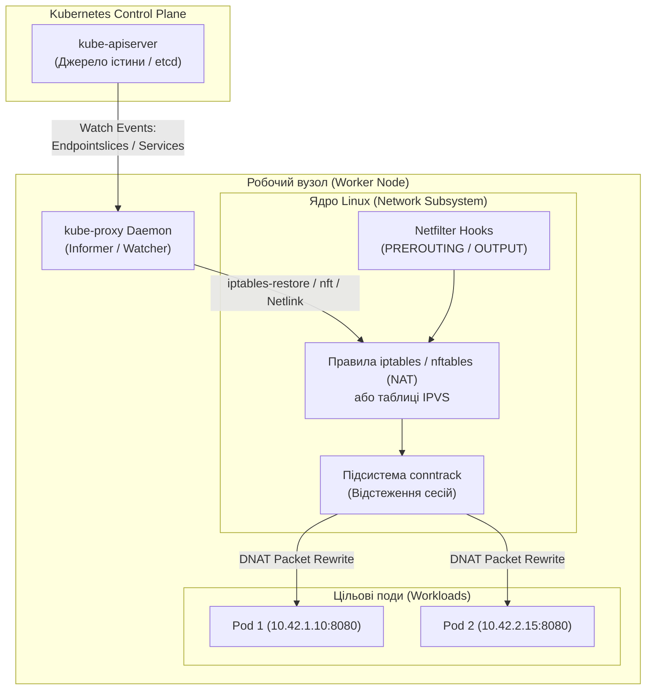
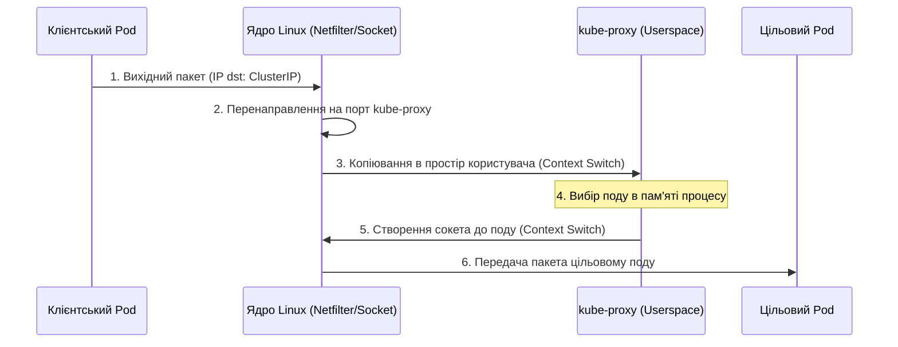
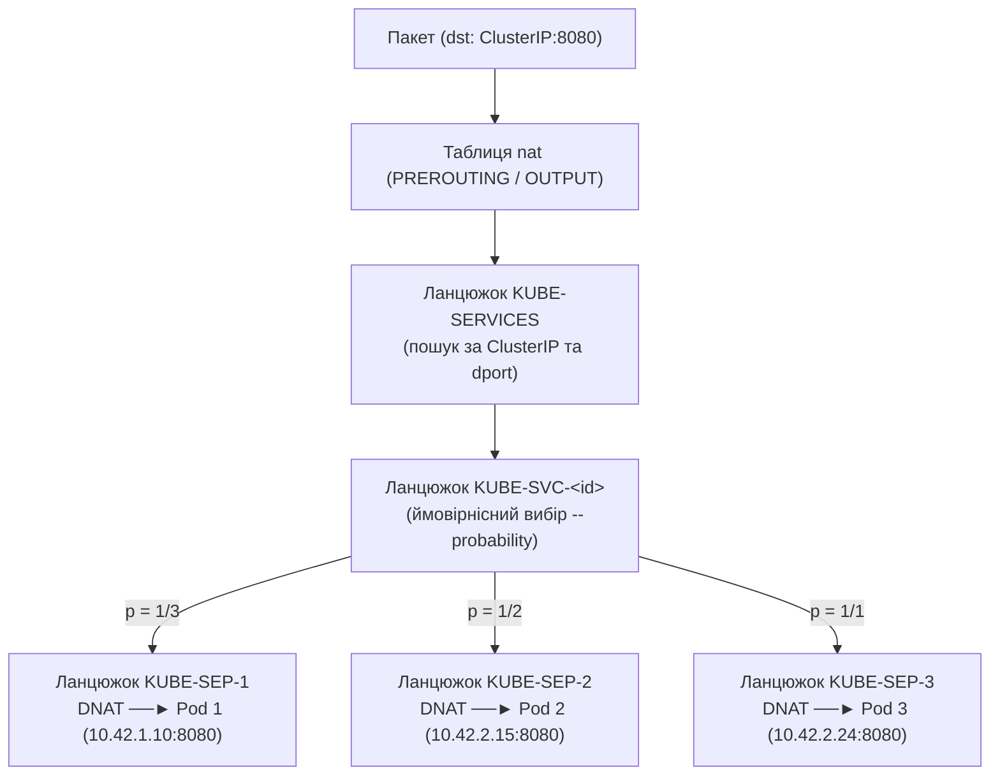
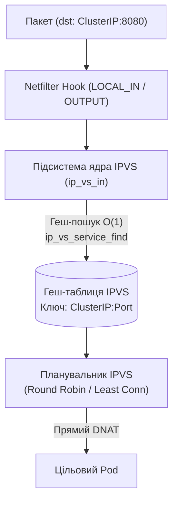
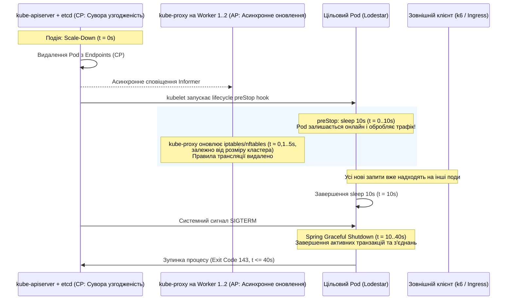

### Анотація

У хмарних розподілених системах балансування навантаження часто сприймається як утилітарна функція інфраструктури, що налаштовується декларативними маніфестами. Проте реальна поведінка трафіку в кластері Kubernetes визначається механізмами ядра Linux (Netfilter, iptables, nftables, IPVS), а наслідки вибору алгоритму -- законами теорії масового обслуговування.

У статті розглянуто шлях від фізичної відсутності адреси `ClusterIP` до режимів роботи `kube-proxy` (iptables, nftables, IPVS) та їхньої вартості в масштабі, з власними вимірюваннями кількості правил і часу їх синхронізації в кластері `k3d` (Kubernetes 1.35). Далі поведінку kube-proxy перевірено експериментально проти передбачень теорії масового обслуговування, записаних до запуску: рівномірність розподілу з'єднань, дисбаланс довгих з'єднань як задача про кулі й комірки, затримки порівняно з балансуванням, що враховує черги, поріг перевантаження пулу з повільним подом, вплив мінливості часу обробки та вибір порогу горизонтального автоскейлінгу (HPA). Насамкінець розглянуто практику плавного масштабування подів на прикладі застосунку `Lodestar`.

## Вступ

### Фізична та логічна сутність ClusterIP

У розподілених системах на базі Kubernetes одним із найпоширеніших хибних уявлень є те, що `ClusterIP` -- це звичайний мережевий інтерфейс, прикріплений до певного процесу або віртуальної машини. Інтуїтивно очікується, що коли в кластері створюється сервіс типу:

```yaml
apiVersion: v1
kind: Service
metadata:
  name: lodestar-service
spec:
  type: ClusterIP
  ports:
    - port: 8080
      targetPort: 8080
  selector:
    app: lodestar
```

і Kubernetes виділяє йому IP-адресу (наприклад, `10.43.80.181`), то десь в операційній системі має з'явитися мережевий сокет, що прослуховує порт 8080. Проте безпосередня інспекція операційної системи на будь-якому вузлі кластера спростовує цю гіпотезу:

```bash
# 1. Перевірка мережевих інтерфейсів ноди
$ ip addr show | grep 10.43.80.181
# Результат: порожній вивід

# 2. Перевірка відкритих портів операційної системи
$ ss -tulpn | grep 8080
# Результат: жодного процесу, який би очікував на з'єднання з 10.43.80.181:8080
```

Адреса `10.43.80.181` фізично не існує на жодному мережевому адаптері, віртуальному мосту (`bridge`) чи veth-парі (за винятком режиму IPVS, де `kube-proxy` примусово створює фіктивний інтерфейс `kube-ipvs0` і прив'язує до нього всі адреси ClusterIP). Ба більше, спроба надіслати ICMP-пакет (`ping 10.43.80.181`) зазвичай завершується стовідсотковою втратою пакетів, якщо ядро спеціально не налаштоване відповідати на такі запити.

З погляду комп'ютерної інженерії `ClusterIP` -- це віртуальна адреса, яка існує лише в правилах трансляції мережевих адрес (Network Address Translation, NAT) і ніколи не виступає безпосередньою точкою завершення TCP-з'єднання. Коли клієнтський процес всередині пода ініціює системний виклик `connect()` до `10.43.80.181:8080`, операційна система не відправляє цей пакет через фізичну лінію зв'язку до віддаленого сервера. Натомість пакет перехоплюється внутрішніми підсистемами ядра Linux ще до моменту передачі на фізичний мережевий пристрій.

### Роль та системна будова kube-proxy

Для перетворення статичних абстракцій API Kubernetes у реальні правила перенаправлення трафіку в ядрі Linux використовується спеціалізований системний демон -- `kube-proxy`.

`kube-proxy` функціонує як агент на кожному робочому вузлі (Worker Node) та вузлах управління (Control Plane nodes) кластера, зазвичай розгортаючись у формі системного `DaemonSet`. Його ключова архітектурна роль полягає не в безпосередній проміжній передачі байтів даних через себе (у сучасних режимах роботи), а у виконанні ролі контролера площини управління (Control Plane Agent) для мережевого стека локального ядра.



Механіка взаємодії `kube-proxy` базується на реактивному шаблоні Observer/Informer:
1. **Підписка на події API Server:** `kube-proxy` встановлює довготривале HTTP-з'єднання (Watch) з `kube-apiserver`, підписуючись на зміни двох фундаментальних ресурсів: `Service` та `EndpointSlice` (або застарілих `Endpoints`).
2. **Асинхронне виявлення змін топології:** Коли контролер розгортання масштабує поди сервісу або коли поди змінюють статус через непроходження Readiness probe, `kube-apiserver` надсилає дельта-подію про оновлення IP-адрес ендпоінтів.
3. **Програмування ядра:** Отримавши оновлення, `kube-proxy` транслює топологію розподіленої системи у правила ядра Linux -- залежно від режиму це iptables, nftables або IPVS. Рішення на базі eBPF (наприклад, Cilium) не є режимом `kube-proxy`: вони замінюють його повністю.

Звідси питання, на які відповідає стаття. Як ядро обирає под для нового з'єднання і чого коштують різні режими kube-proxy у масштабі? Наскільки рівномірно цей вибір розподіляє трафік, зокрема коли з'єднання довгі? І що випадковий вибір означає для затримок: на однакових і неоднакових подах, за мінливого часу обробки та під час горизонтального автоскейлінгу? Відповіді перевірено вимірами в кластері проти передбачень теорії масового обслуговування, записаних до запуску.

## Еволюція механіки ядра

Балансування трафіку в Kubernetes пройшло кілька послідовних ітерацій, що відображають оптимізацію витрат обчислювальних ресурсів операційної системи.

### Режим Userspace: Подвійне перемикання контексту та копіювання буферів

На ранніх етапах розвитку Kubernetes (версії 1.0–1.1) демон `kube-proxy` за замовчуванням функціонував як повноцінний проксі-сервер простору користувача (Userspace Proxy). Режим залишався доступним як альтернативний і був остаточно видалений у Kubernetes 1.26.



Вузькі місця підходу:
* **Подвійне перемикання контексту:** Кожен мережевий пакет двічі долав межу між простором ядра (`kernel-space`) та простором користувача (`user-space`).
* **Копіювання буферів пам'яті:** Байти переміщувалися з буферів ядра (`sk_buff`) у пам'ять процесу `kube-proxy` і назад.
* **Непродуктивне навантаження на CPU:** Процесор витрачав ресурси на системні виклики `read()`/`write()` та обробку переривань.

### Режим iptables: Netfilter, ланцюжки ймовірностей та вартість у масштабі

Починаючи з Kubernetes 1.2, стандартним режимом роботи став `iptables mode` (він лишається режимом за замовчуванням і в Kubernetes 1.35). У цьому режимі `kube-proxy` усувається зі шляху проходження пакетів (Data Path), а весь тягар балансування покладається на підсистему **Netfilter**.



Суфікс у назві ланцюжка `KUBE-SVC-<id>` -- лише ідентифікатор, обчислений як геш від імені Service і порту. Сам вибір пода не використовує гешування: це псевдовипадкове правило модуля `statistic`, яке спрацьовує для **першого пакета нового з'єднання**. Далі підсистема `conntrack` направляє всі наступні пакети цього з'єднання на той самий под.

#### Математична реалізація балансування через ймовірнісні фільтри
Для забезпечення рівномірного розподілу між $n$ бекендами ймовірність спрацьовування кожного правила в ланцюжку `KUBE-SVC-*` розраховується за формулою:

$$P(i) = \frac{1}{n - i + 1}, \quad \text{де } i \in \{1, 2, \dots, n\}$$

Для трьох реплік ($n = 3$):
1. **Правило 1:** $P_1 = \frac{1}{3 - 1 + 1} = \frac{1}{3} \approx 0.3333$.
2. **Правило 2:** $P_2 = \frac{1}{3 - 2 + 1} = \frac{1}{2} = 0.5$. Результуюча ймовірність: $\left(1 - \frac{1}{3}\right) \times \frac{1}{2} = \frac{1}{3}$.
3. **Правило 3:** $P_3 = 1.0$. Результуюча ймовірність: $\left(1 - \frac{1}{3}\right) \times \left(1 - \frac{1}{2}\right) \times 1.0 = \frac{1}{3}$.

Ці значення легко побачити в реальному кластері. Для сервісу `lodestar-service` з чотирма подами (k3s v1.35):

```bash
$ iptables-save -t nat | grep '^-A KUBE-SVC-MDIGSTGLQNLVZ46S'
... -m statistic --mode random --probability 0.25000000000 -j KUBE-SEP-MOYLOLTX5HYYZL7Z
... -m statistic --mode random --probability 0.33333333349 -j KUBE-SEP-K7PWSZBFLFY7DJR5
... -m statistic --mode random --probability 0.50000000000 -j KUBE-SEP-LZJXFBHWVMZR5OZR
... -j KUBE-SEP-NXQTUZU3LFNCSIJQ
```

#### Вартість режиму iptables у масштабі: вимірювання
Теоретичний аргумент проти iptables звучить так: правила в ланцюжку перевіряються послідовно, тож пошук для першого пакета з'єднання має складність $O(N)$ за кількістю Service. Щоб оцінити, наскільки це помітно на практиці, я створював у кластері `k3d` (k3s v1.35, лептоп) від 0 до 2000 фіктивних Service, кожен з яких вибирав 4 поди, і вимірював розмір таблиці `nat` та метрики самого `kube-proxy` (`kubeproxy_sync_*_proxy_rules_duration_seconds`). Кожен вимір зроблено одним прогоном, тому важливий порядок величин, а не окремі значення.

| Кількість Service | Рядків у таблиці `nat` | Часткова синхронізація, мс | Повна синхронізація, мс |
| ---: | ---: | ---: | ---: |
| 0 | 67 | -- | 46 |
| 500 | 9 135 | 110 | 156 |
| 1 000 | 15 906 | 131 | 303 |
| 2 000 | 24 960 | 173 | 1 147 |

Спостереження:
1. **Кількість правил росте лінійно з добутком Service × Endpoint.** Кожен Service із 4 подами додає приблизно 15–19 рядків: правило в `KUBE-SERVICES`, ланцюжок `KUBE-SVC-*` із правилом на кожен под і по ланцюжку `KUBE-SEP-*` на кожен под. Для 2000 Service це вже десятки тисяч рядків.
2. **Затримка пошуку на шляху пакета практично невидима.** Обхід навіть 2000 правил `KUBE-SERVICES` займає мікросекунди і стосується лише першого пакета з'єднання. На тлі мережевих затримок у кластері цю складову не вдалося виміряти.
3. **Головна вартість -- синхронізація правил.** Повна перебудова таблиці росте надлінійно: на 2000 Service вона займала 1,1 с в одновузловому кластері і 5,6 с у навантаженому тривузловому. Поки синхронізація триває, зміни endpoint-ів (нові та видалені поди) ще не діють на вузлі.
4. **Сучасний kube-proxy не переписує таблицю повністю при кожній зміні.** Починаючи з Kubernetes 1.28, за замовчуванням виконується *часткова* синхронізація: передаються лише змінені ланцюжки. У вимірах вона займала 110–173 мс проти 1,1 с для повної. Повна синхронізація відбувається при старті та періодично. Ще одна деталь: у сучасних дистрибутивах утиліта `iptables` часто працює поверх бекенду `nf_tables` ядра (`iptables v1.8.11 (nf_tables)` у k3s), тобто «послідовні ланцюжки» -- це модель правил, а не обов'язково фізична структура даних ядра.

### Режим IPVS (IP Virtual Server): $O(1)$

Режим **IPVS** (стабілізовано в K8s 1.11) замінює послідовні ланцюжки Netfilter на **геш-таблиці** ядра Linux:



| Характеристика | iptables Mode | IPVS Mode |
| :--- | :--- | :--- |
| **Базова структура даних** | Послідовні ланцюжки правил | **Геш-таблиці (`hash tables`)** |
| **Алгоритмічна складність пошуку** | **$O(N)$** за кількістю Service | **$O(1)$** |
| **Механіка оновлення** | `iptables-restore` (з K8s 1.28 -- часткове, лише змінені ланцюжки) | Оновлення окремих записів через **Netlink** |
| **Алгоритми розподілу** | Виключно псевдовипадковий вибір | Round Robin, Least Connection, Source/Destination Hashing, Weighted |

IPVS забезпечує сталий час пошуку незалежно від масштабу кластера, але iptables у цьому режимі не зникає: його правила (разом з `ipset`) відповідають за маскарадинг і фільтрацію.

**Важливо:** у Kubernetes 1.35 режим IPVS оголошено застарілим (KEP-5495) -- у SIG Network бракує супровідників цього коду, а як заміну рекомендовано режим nftables. Тому IPVS варто розглядати як історичний етап, а не як ціль міграції.

### Режим nftables

Режим **nftables** з'явився в Kubernetes 1.29 і став загальнодоступним (GA) у 1.33. Він використовує сучасний інтерфейс Netfilter: замість довгих послідовних ланцюжків пошук сервісу виконується через **verdict maps** -- асоціативні структури, що відображають `ClusterIP:порт` на ланцюжок сервісу за один пошук. Оновлення передаються в ядро транзакціями.

У тому самому експерименті nftables-режим показав швидшу повну синхронізацію на 2000 Service (0,8 с проти 1,1 с), але повільнішу часткову (330–795 мс проти 110–173 мс). Цей результат одного прогону, і його не варто узагальнювати: у kube-proxy v1.36 побудову правил nftables суттєво оптимізовано. Висновок обмежений: різниця між режимами проявляється насамперед у вартості синхронізації, а не в швидкості обробки окремого пакета.

Усі три режими працюють на рівні L4 і тому мають спільне обмеження щодо довгих сесій, яке розглянуто нижче.

## Фундаментальні теореми та закони

### Межа L4: з'єднання замість запитів

Транспортні балансувальники навантаження (`kube-proxy`) приймають рішення про вибір пода лише в момент встановлення нового з'єднання -- зокрема, у момент першого TCP-пакета `SYN`. Запис у підсистемі ядра `conntrack` фіксує прив'язку сесії на основі 5-tuple (src/dst IP, src/dst port, протокол).

Коли з'єднання довготривале -- HTTP/1.1 Keep-Alive (послідовні запити в одному з'єднанні) або HTTP/2 і gRPC (паралельні запити, мультиплексовані в одному з'єднанні) -- усі запити цього з'єднання йдуть на один под. Якщо клієнтів мало, а з'єднання живуть довго (типовий випадок для gRPC між сервісами), **усі запити клієнта потрапляють на один под**, тоді як решта реплік лишаються ненавантаженими. Нові поди, створені HPA, не отримують трафіку від уже відкритих з'єднань. Як розподіляти саме запити -- на клієнті, в Ingress або в service mesh -- розглянуто в окремій статті про балансування на рівні L7.

### Сила двох виборів (Power of Two Choices)

Розподіл навантаження між $n$ вузлами формалізується класичною задачею розміщення $n$ куль по $n$ комірках:
1. **Випадок $d = 1$ (чисто випадковий вибір, аналог iptables):** максимальне заповнення комірки з високою ймовірністю становить
   $$L_{\max}^{(d=1)} = \frac{\ln n}{\ln \ln n} \cdot (1 + o(1))$$
2. **Випадок $d = 2$ (кожна куля кладеться в менш заповнену з двох випадкових комірок):**
   $$L_{\max}^{(d=2)} = \frac{\ln \ln n}{\ln 2} + \Theta(1)$$

Цей результат довели Azar, Broder, Karlin та Upfal (1994). Mitzenmacher (2001) переніс ідею на динамічні системи з чергами (так звана supermarket model): якщо кожен запит обирає коротшу з двох випадкових черг, ймовірність довгої черги спадає подвійно експоненційно з її довжиною, а не експоненційно, як при випадковому виборі.

Обидва результати -- **асимптотичні** ($n \to \infty$). На малій кількості бекендів (3–5 подів) вони дають лише якісний орієнтир: вибір із двох кандидатів має помітно вирівнювати черги порівняно з випадковим вибором і не потребує опитування всіх серверів. Кількісно на такому масштабі ефект перевіряється тільки вимірюванням.

**Що це означає для kube-proxy.** Режим iptables -- це саме випадок $d = 1$, але «кулями» є **з'єднання**, а не запити. Поки з'єднання короткі, кожен запит -- нова куля, і закон великих чисел вирівнює навантаження. Коли з'єднання довгі (gRPC, HTTP/2, пули з'єднань з keep-alive), $m$ клієнтських з'єднань один раз розкладаються по $n$ подах і так лишаються. Тоді важливе відношення $m/n$, і модель дає три режими:
* **$m/n < 1$ -- клієнтів менше, ніж подів.** Частка подів без жодного з'єднання $\left(1 - \frac{1}{n}\right)^m \approx e^{-m/n}$: при 5 клієнтах і 10 подах -- близько 60%. Масштабування сервісу в цьому режимі майже не допомагає: нові поди не отримують трафіку.
* **$m/n = 1$ -- розріджений режим**, де діє $\ln n / \ln \ln n$: для 10 подів і 10 з'єднань найзавантаженіший под у середньому тримає 2,75 з'єднання замість одного, а третина подів простоює.
* **$m/n \gg 1$ -- щільний режим.** Максимум перевищує середнє $m/n$ приблизно на $\sqrt{2 (m/n) \ln n}$. Абсолютний перекіс росте, але відносний зменшується: при 100 з'єднаннях на 10 подів найзавантаженіший под тримає в середньому близько 15 замість 10.

Ці передбачення перевірено на кластері в розділі «Як kube-proxy розподіляє трафік: експерименти».

### Закон Літтла ($L = \lambda W$) та сліпота рівня L4

Фундаментальний закон теорії масового обслуговування (John Little, 1961):

$$L = \lambda W$$

де $L$ -- середня кількість активних in-flight запитів, $\lambda$ -- інтенсивність потоку, $W$ -- середній час відгуку.

Балансувальник рівня L4 (`kube-proxy`) розподіляє з'єднання, а не запити: він не бачить окремих HTTP/gRPC запитів усередині з'єднання і не знає, скільки з них зараз обробляє кожен под. Тобто він не керує величиною $L$ на поді. Отже, утримання $L$ одночасних запитів повністю лягає на застосунок.

### Формула Кінгмана та поріг HPA

Час очікування в черзі $G/G/1$ за формулою Кінгмана (1961):

$$W_q \approx \left(\frac{c_a^2 + c_s^2}{2}\right) \cdot \left(\frac{\rho}{1 - \rho}\right) \cdot \frac{1}{\mu}$$


*Рис. Залежність часу очікування в черзі $W_q$ від утилізації процесора $\rho$: гіперболічне зростання затримки при $\rho \to 1$. Поріг HPA $\theta$ безпечний, поки після стрибка навантаження в $g$ разів утилізація $\theta \cdot g$ лишається нижчою за 1: для $g = 2$ це $\theta \le 45\%$, для $g = 1{,}5$ -- $\theta \le 60\%$ (перевірено в експерименті 5 нижче).*

Поведінка члена $\frac{\rho}{1 - \rho}$:
* При $\rho = 0.60$ (60% CPU): коефіцієнт $1.5$;
* При $\rho = 0.80$ (80% CPU): коефіцієнт $4.0$;
* При $\rho = 0.90$ (90% CPU): коефіцієнт $9.0$.

Перший множник $\frac{c_a^2 + c_s^2}{2}$ -- це мінливість потоку: $c_a$ і $c_s$ -- коефіцієнти варіації інтервалів між запитами та часу обслуговування. Для пуассонівського потоку від багатьох незалежних клієнтів $c_a^2 = 1$, для запитів через рівні проміжки $c_a^2 = 0$. За експоненційного часу обслуговування ($c_s^2 = 1$) рівномірний потік дає вдвічі меншу чергу, ніж пуассонівський за того самого $\rho$. Так само діє і мінливість обслуговування: для одного сервера з пуассонівським потоком ($M/G/1$) формула Поллачека -- Хінчина дає точне значення $W_q = \frac{\rho}{1-\rho} \cdot \frac{1 + c_s^2}{2} \cdot \frac{1}{\mu}$, тобто черга росте лінійно з $c_s^2$. Запити з «важким хвостом» часу обробки (повільні звіти поруч зі швидкими читаннями) подовжують черги навіть за помірного завантаження. Звідси практичний наслідок для навантажувального тестування: генератор, що подає запити через рівні проміжки (наприклад, режим `constant-arrival-rate` у k6), систематично занижує черги порівняно з реальним трафіком. Під час калібрування стенда для експериментів у цій статті це довелося побачити на власних вимірах: на тому самому поді при $\rho = 0.9$ рівномірний потік з k6 дав P95 217 ± 72 мс, пуассонівський -- 397 ± 219 мс, а модель $M/M/4$ передбачає 418 мс. Інтервали широкі, бо біля насичення розкид між прогонами великий, але напрямок і порядок ефекту збігаються з формулою.

Формула сама не задає порогу, але разом з очікуваним стрибком навантаження дає умову для нього. Між моментом сплеску й появою нових подів минає $T_{\text{reaction}}$ -- десятки секунд (збір метрик, рішення HPA, планування й старт JVM). Весь цей час навантаження несуть наявні поди: якщо поріг $\theta$, а навантаження зросло в $g$ разів, їхнє завантаження стає $\theta \cdot g$. Поки $\theta \cdot g < 1$, черги лишаються обмеженими; щойно $\theta \cdot g \ge 1$, черга росте весь час реакції. Для стрибка в півтора раза це $\theta < 0{,}67$, тож поріг 60% -- не довільний вибір: 65% уже лежить на межі, а 70% -- за нею. Експеримент нижче це перевіряє.

Ще одна практична деталь: HPA рахує утилізацію **відносно `requests`**, а не відносно фізичного ліміту. У Lodestar `requests.cpu = 250m`, а `limits.cpu = 1000m`, тож «60% CPU» для HPA -- це 150m, тобто приблизно 0,15 ядра з доступного одного. Величина $\rho$ у формулі Кінгмана -- це завантаження відносно реальної ємності, і при `requests < limits` вона може бути значно нижчою за відсоток, який показує HPA. Це важливо для інтерпретації стрес-тесту нижче.

### Принцип кінцевих точок (End-to-End Arguments)

Згідно з принципом Зальцера, Ріда та Кларка (Saltzer et al., 1984), низькорівневий L4 рівень не здатен гарантувати успішність виконання бізнес-транзакції. Навіть при коректному перенаправленні TCP SYN пакет може надійти на екземпляр з вичерпаним пулом БД або завислою JVM. Повна надійність забезпечується механізмами рівня L7: **Circuit Breaker**, **Idempotent Retry з експоненційним відступом** та ізольованими **Health Probes**.

## Як kube-proxy розподіляє трафік: експерименти

Правила в ланцюжках iptables показують, як kube-proxy *задумано* розподіляти з'єднання. Щоб перевірити, як він розподіляє їх насправді і що це означає для затримок, я провів серію експериментів в окремому кластері. Кожен експеримент перевіряє конкретне передбачення з теоретичного розділу, записане до запуску.

### Методологія та межі

* **Стенд.** Кластер `k3d` (k3s v1.35, kube-proxy у режимі iptables): керуючий вузол, вузол для генераторів навантаження і вузол для бекендів. Вузлам призначено окремі ядра CPU, щоб генератор не конкурував із бекендами.
* **Бекенд** ([`SimBackend`](https://github.com/Olezha/Load-balancer/blob/main/core/src/SimBackend.java){:target="_blank" rel="noopener noreferrer"}): 4 обробники й експоненційний час обслуговування із середнім 50 мс, тобто ємність 80 запитів/с на под. За пуассонівського потоку кожен под -- система $M/M/4$, і її затримки можна передбачити заздалегідь. У відповіді под повертає своє ім'я, що дає змогу рахувати розподіл.
* **Генератор навантаження** ([`LoadGen`](https://github.com/Olezha/Load-balancer/blob/main/core/src/LoadGen.java){:target="_blank" rel="noopener noreferrer"}): пуассонівські надходження, нове TCP-з'єднання на кожен запит, затримка рахується від запланованого моменту запиту. Остання умова важлива: якщо генератор відстає, повільні відповіді не повинні випадати з вимірів.
* **Калібрування.** Перед порівнянням балансувальників один под без балансувальника перевірено на відповідність моделі $M/M/4$: порівнянням можна довіряти, лише якщо стенд поводиться як модель. При $\rho = 0.7$ виміряні P50 / P95 / P99 -- 52 / 179 / 259 мс (модель: 52 / 187 / 276 мс), при $\rho = 0.9$ -- 102 / 397 / 534 мс (модель: 113 / 418 / 615 мс), розбіжності в межах довірчих інтервалів трьох прогонів. Перша спроба калібрування з k6 моделі не збіглася саме через рівномірний потік запитів (розділ про формулу Кінгмана), тож генератор було замінено.
* **Повтори.** Якщо не вказано інше, кожна конфігурація -- 3–5 прогонів у випадковому порядку, прогрів 10 с, вимір 60 с; наведено середнє і 95% довірчий інтервал.
* **Еталон для порівняння.** Щоб відокремити вплив випадкового вибору від решти стенда, той самий трафік пропускається через мінімалістичний L7-проксі ([`L7LoadBalancer`](https://github.com/Olezha/Load-balancer/blob/main/core/src/L7LoadBalancer.java){:target="_blank" rel="noopener noreferrer"}), що розподіляє кожен запит за одним з алгоритмів: Round Robin (RR), найменше запитів у роботі (Least Connections, LC) або вибір кращого з двох випадкових подів (Power of Two Choices, P2C). Проксі тут лише вимірювальний інструмент; балансування на рівні L7 -- тема окремої статті.
* **Межі.** Усе працює на одній машині, тож абсолютні затримки містять мережеві накладні витрати віртуальних інтерфейсів. Бекенди синтетичні: модель перевіряє вплив розподілу на черги, а не поведінку конкретного застосунку.

Код, передбачення, обґрунтування параметрів і журнал методології -- у [`kube-proxy-lab`](https://github.com/Olezha/Load-balancer/tree/main/kube-proxy-lab){:target="_blank" rel="noopener noreferrer"}.

### Нові з'єднання: чи рівномірний вибір

Перше питання -- чи справді ланцюжок правил із ймовірностями $1/(n-i+1)$ дає рівномірний розподіл. Зонд відкриває нові з'єднання до ClusterIP з двох вузлів (у кожного вузла власні правила kube-proxy), у кожному з'єднанні робить 5 запитів і фіксує, який под відповів. Для $n$ = 2, 3, 5, 10, 20, 50, 100 подів -- 500 з'єднань на под, не менше 10 000 загалом; рівномірність перевірено критерієм $\chi^2$. За такої кількості з'єднань тест помічає відхилення частки пода приблизно від 5% і більше.

| Подів $n$ | З'єднань | $\chi^2$ | Ступенів свободи | $p$ |
| ---: | ---: | ---: | ---: | ---: |
| 2 | 10 000 | 0,19 | 1 | 0,66 |
| 3 | 10 000 | 8,74 | 2 | 0,013 |
| 3 (повтор) | 10 000 | 1,19 | 2 | 0,55 |
| 5 | 10 000 | 1,73 | 4 | 0,79 |
| 10 | 10 000 | 16,36 | 9 | 0,06 |
| 20 | 10 000 | 19,20 | 19 | 0,44 |
| 50 | 25 000 | 49,55 | 49 | 0,45 |
| 100 | 50 000 | 83,98 | 99 | 0,86 |

Для $n = 3$ перший прогін дав $p = 0{,}013$: один под отримав 34,7% з'єднань. Тестів сім, тож одне значення нижче 0,05 цілком можливе випадково, а з поправкою Бонферроні на кількість тестів ($0{,}05 / 7 \approx 0{,}007$) воно незначуще. Рішення повторити замір на нових подах я записав до повтору; повтор дав $p = 0{,}55$. Отже, відхилень від рівномірності не виявлено для жодного $n$, включно зі 100 подами, де ланцюжок містить 100 правил з ймовірностями до $1/100$.

Усі 125 000 з'єднань були «липкими»: п'ять запитів у межах одного з'єднання завжди потрапляли на той самий под. Це робота `conntrack`: правила iptables застосовуються лише до першого пакета з'єднання.

### Довгі з'єднання: перевірка моделі куль і комірок

Одна спроба експерименту -- це $m$ клієнтів, які одночасно відкривають довгі з'єднання до ClusterIP сервісу з $n$ подами. Для кожного з'єднання фіксується под, на який його направив kube-proxy, тобто розподіл, що лишиться незмінним до закриття з'єднань. Для кожної пари $(n, m)$ зроблено 1000 спроб (300 для $m \ge 500$), $n$ = 2, 3, 5, 10, 20, 50, 100 подів, $m/n$ = 0,5, 1 і 10. Модельні значення отримано імітацією незалежного рівноймовірного вибору.


*Рис. Ліворуч -- середня кількість з'єднань на найзавантаженішому поді, праворуч -- частка подів, що не отримали жодного з'єднання. Лінії -- модель, точки -- kube-proxy (k3s v1.35) з 95% довірчими інтервалами. При $n = 3$ значення $m = \lceil 3/2 \rceil = 2$, тож клієнтів відносно більше, звідси злам помаранчевої кривої.*

Модель збіглася з вимірами в усіх 21 точці: середнє максимальне навантаження і кількість порожніх подів лежать у межах похибки від передбачень, а розподіл максимуму не відрізняється від модельного за критерієм $\chi^2$ (у всіх точках $p > 0{,}3$). Кілька значень:

| Поди $n$ | Клієнти $m$ | Порожніх подів: модель / вимір | Макс. з'єднань на под: модель / вимір | Ідеал |
| ---: | ---: | ---: | ---: | ---: |
| 10 | 5 | 5,90 / 5,90 | 1,79 / 1,79 | 1 |
| 10 | 10 | 3,49 / 3,50 | 2,75 / 2,75 | 1 |
| 10 | 100 | 0 / 0 | 15,1 / 15,1 | 10 |
| 100 | 50 | 60,5 / 60,5 | 2,96 / 2,95 | 1 |
| 100 | 100 | 36,6 / 36,7 | 4,23 / 4,26 | 1 |

Практичний висновок. Для довгих з'єднань kube-proxy поводиться точно як випадковий вибір, тож його наслідки можна рахувати заздалегідь. Якщо сервіс має менше клієнтських з'єднань, ніж подів, частка $e^{-m/n}$ подів (для $m = n/2$ -- близько 60%) не отримає трафіку взагалі, і горизонтальне масштабування не дасть ефекту, доки клієнти не перевідкриють з'єднання. Навіть коли з'єднань стільки ж, скільки подів, найзавантаженіший под тримає їх у 2,7–4,3 раза більше за середнє (для 10–100 подів).

### Випадковий вибір проти балансування з урахуванням черг

Наслідки випадкового вибору видно в затримках. Генератор відкриває нове з'єднання на кожен запит, тож kube-proxy обирає под для кожного запиту окремо, і це найсприятливіший для нього режим. Той самий потік пропускається через L7-проксі з алгоритмами RR, LC і P2C. Прогрів 10 с, вимір 60 с, 5 повторів у випадковому порядку, середнє і 95% довірчий інтервал.

Модель робить два кількісні передбачення:
* **Однакові поди, $\rho = 0.9$.** Випадковий розподіл пуассонівського потоку робить кожен под незалежною системою $M/M/4$ з тим самим $\rho$, тож P95 близько 410–420 мс незалежно від кількості подів. Алгоритм, що бачить черги, наближається до спільної черги на всі поди ($M/M/12$ для 3 подів, $M/M/40$ для 10), а вона дає нижню межу P95: 203 і 157 мс.
* **Один повільний под** (ємність 40 запитів/с замість 80, загальне $\rho = 0.7$). Випадковий розподіл надсилає йому $\lambda/n$, тобто 46,7 запиту/с для 3 подів і 53,2 для 10 подів, більше за його ємність. Його черга росте весь тест, і хвіст затримок вимірюється секундами. LC і P2C мають зменшити його частку і втримати P95 у сотнях мілісекунд.

| Сценарій | Подів | kube-proxy | RR | LC | P2C | Передбачення |
| :--- | ---: | ---: | ---: | ---: | ---: | :--- |
| Однакові, $\rho = 0.9$: P95, мс | 3 | 453 ± 128 | 325 ± 43 | 208 ± 14 | 228 ± 20 | ≈ 415 / ≥ 203 |
| | 10 | 447 ± 79 | 260 ± 6 | 165 ± 3 | 173 ± 3 | ≈ 415 / ≥ 157 |
| Один повільний под: P95, мс | 3 | 10 591 ± 1 741 | 9 802 ± 2 377 | 194 ± 5 | 205 ± 4 | секунди / сотні мс |
| | 10 | 18 493 ± 5 263 | 13 501 ± 1 398 | 160 ± 1 | 167 ± 2 | секунди / сотні мс |
| Частка повільного пода | 3 | 33,1% | 33,3% | 19,7% | 22,9% | $1/n$ / менше |
| | 10 | 10,5% | 10,0% | 4,9% | 6,3% | $1/n$ / менше |

RR у сценарії з повільним подом виміряно з тайм-аутом проксі 60 с, як у генератора: з коротшим тайм-аутом проксі відповідав помилкою на найповільніші запити, і затримки RR виходили заниженими.

Обидва передбачення підтвердилися. З однаковими подами kube-proxy дає саме ту затримку, яку модель передбачає для незалежних черг, а LC і P2C підходять до нижньої межі спільної черги впритул: черги, які випадковий вибір лишає нерівними, алгоритм з інформацією про завантаження вирівнює, і P95 падає вдвічі-втричі. RR займає проміжне місце: він рівномірний, але не бачить, що на поді вже зібралася черга.

З повільним подом різниця якісна. kube-proxy дає йому рівно $1/n$ трафіку, і його черга росте необмежено. Показово, що для 10 подів медіана затримки лишається здоровою -- 58 мс, бо повільний под отримує лише кожен десятий запит, -- а P95 сягає 18 с. Моніторинг середньої або медіанної затримки такої проблеми не покаже, тож для сервісів за kube-proxy стежити варто за P95/P99 і за затримкою окремих подів. RR тут не кращий за kube-proxy: він теж віддає повільному поду рівно $1/n$ запитів, лише в іншому порядку. LC і P2C самі зменшують частку повільного пода приблизно вдвічі і тримають P95 близько 160–200 мс.

### Поріг перевантаження

Сценарій з повільним подом дає ще одне кількісне передбачення: точку, де випадковий вибір перестає справлятися. Повільний под отримує $\lambda/n$, тож він перевантажений, коли $\lambda/n$ перевищує його ємність $\mu_{\text{slow}}$, тобто коли загальне завантаження $\rho > \rho^* = \frac{n \, \mu_{\text{slow}}}{\sum_i \mu_i}$. Для 10 подів, де дев'ять мають ємність 80 запитів/с, а один -- 40, $\rho^* = 400/760 \approx 0{,}526$. Нижче порогу затримка повільного пода росте за формулою Кінгмана, гіперболічно, вище -- черга зростає весь тест. P2C повинен тримати затримку незмінною в усьому діапазоні.


*Рис. P95 затримки залежно від загального завантаження пулу з 10 подів, один з яких удвічі повільніший. Лінії -- модель (дискретно-подійна імітація), точки -- виміри з 95% довірчими інтервалами: 3 прогони на точку, для $\rho = 0{,}7$ -- 5 прогонів з попереднього експерименту. Пунктир -- передбачений поріг $\rho^* = 0{,}526$.*

Виміри повторюють форму модельної кривої. До порогу P95 kube-proxy росте поступово -- 177, 191, 222 мс при $\rho$ = 0,30, 0,40, 0,45 -- і вже при 0,50 (436 мс) входить у круту частину гіперболи. Після порогу P95 вимірюється секундами: 2,9 с при 0,55, 5,7 с при 0,60 і 18,5 с при 0,70. Біля порогу розкид між прогонами великий -- черга то встигає розсмоктатися за час тесту, то ні, -- тому інтервали там широкі, але положення злому збігається з передбаченим. P2C в усьому діапазоні тримає P95 на рівні 164–167 мс.

Практичний висновок: за випадкового розподілу ємність пулу визначає найповільніший под, а не сумарна потужність. Пул із десяти подів, де один удвічі повільніший, через kube-proxy можна безпечно завантажити лише приблизно наполовину, хоча сумарно він має 95% ємності однорідного пулу. Медіана при цьому лишається оманливо спокійною: 40–58 мс в усіх точках.

### Мінливість часу обробки

Формули Кінгмана і Поллачека -- Хінчина кажуть, що черга росте лінійно з квадратом коефіцієнта варіації часу обробки $c_s^2$. У реальному сервісі він рідко буває малим: поруч зі швидкими читаннями трапляються повільні звіти, запити до холодного кешу, паузи GC. Випадковий вибір не бачить, що под зайнятий довгим запитом, і продовжує надсилати туди нові; балансувальник, що рахує запити в роботі, обходить такий под. Тож перевага балансування з урахуванням черг має рости з мінливістю.

**Експеримент.** 10 однакових подів, середній час обробки 50 мс, завантаження $\rho = 0.8$; змінюється лише розподіл часу обробки при тому самому середньому: сталий ($c_s^2 = 0$), експоненційний ($c_s^2 = 1$) і суміш коротких і довгих запитів ($c_s^2 = 4$ і $16$; при $c_s^2 = 16$ близько 97% запитів тривають у середньому 26 мс, решта -- близько 0,8 с). 5 повторів.


*Рис. P95 затримки для чотирьох розподілів часу обробки з однаковим середнім. Стовпці -- виміри з 95% довірчими інтервалами (5 прогонів), пунктирні контури -- передбачення імітаційної моделі, записані до запуску. Вісь ординат логарифмічна.*

| $c_s^2$ | kube-proxy | RR | LC | P2C |
| ---: | ---: | ---: | ---: | ---: |
| 0 | 130 ± 5 | 66 ± 8 | 64 ± 5 | 74 ± 1 |
| 1 | 239 ± 18 | 181 ± 8 | 154 ± 2 | 160 ± 1 |
| 4 | 491 ± 54 | 465 ± 99 | 193 ± 7 | 205 ± 6 |
| 16 | 1 459 ± 169 | 1 335 ± 149 | 115 ± 14 | 149 ± 12 |

Усі три передбачення підтвердилися:
* **Перевага балансування з урахуванням черг росте з мінливістю.** P95 kube-proxy більший за P2C у 1,8, 1,5, 2,4 і 9,8 раза (передбачення: 1,8, 1,5, 2,4 і 8,6).
* **Round Robin корисний лише за сталого часу обробки.** При $c_s^2 = 0$ він нарівні з LC, бо рівномірна черговість якраз і вирівнює однакові запити; уже при $c_s^2 \ge 4$ він не кращий за випадковий вибір.
* **Неочевидне: за дуже мінливого часу обробки P95 у LC і P2C *знижується*** -- 115 мс при $c_s^2 = 16$ проти 193 мс при $c_s^2 = 4$ (модель: 114 і 191). Коротких запитів тут 97%, і балансувальник спрямовує їх на поди, не зайняті довгими. Довгі запити при цьому нікуди не зникають: їх видно в P99 -- 914 мс для LC.

Практичний висновок: що різнорідніші запити сервісу, то дорожче коштує випадковий розподіл kube-proxy. Для сервісу, де повільні запити змішані зі швидкими, різниця в хвості затримок сягає порядку.

### Поріг HPA і стрибок навантаження

**Як це виміряно** (експеримент 5, передбачення записано до запуску). Поди, що витрачають на кожен запит 20 мс процесора (один обробник, `requests.cpu = 1000m`, тож відсоток HPA збігається з реальною утилізацією); 4 поди при утилізації $\theta$ упродовж 120 с, потім стрибок навантаження в 1,5 раза на 240 с. HPA з цільовим значенням $\theta$, від 4 до 8 подів. P95, мс: передбачення / виміряне (3 повтори, 95% довірчий інтервал):

| $\theta$ | $\theta \cdot g$ | P95 за перші 60 с після стрибка | P95 за весь стрибок |
| ---: | ---: | ---: | ---: |
| 0,5 | 0,75 | 173 / 150 ± 67 | 128 / 122 ± 24 |
| 0,6 | 0,90 | 376 / 394 ± 278 | 186 / 211 ± 28 |
| 0,7 | 1,05 | 1 609 / 2 699 ± 2 620 | 897 / 1 482 ± 1 038 |
| 0,8 | 1,20 | 5 523 / 6 622 ± 4 150 | 4 457 / 5 761 ± 3 669 |

* **Коліно -- між 60% і 70%, там, де $\theta \cdot g$ перетинає 1.** P95 за весь стрибок зростає з 211 до 1 482 мс, у сім разів, тоді як між 50% і 60% -- менш ніж удвічі.
* **HPA реагує за 15–35 с** (медіана 30 с) від стрибка до готовності першого нового пода -- повільніше за 23 с у моделі. Тому вище коліна виміряні затримки більші за передбачені, але саме коліно на місці.
* **Ціна низького порогу -- запас потужності.** При 60% на 100 запитів за секунду потрібно 3,3 пода, при 70% -- 2,9: приблизно на 17% більше ресурсів дають усемеро менший P95 під час стрибка. При 50% HPA у двох прогонах із трьох додав под ще до стрибка, просто через коливання утилізації.

Поріг, отже, визначає не формула сама по собі, а очікуваний стрибок: для $g$ = 1,5 безпечно $\theta \le 0{,}6$, для $g$ = 2 -- уже $\theta \le 0{,}45$.

## Кластер Lodestar під стрес-тестом у Kubernetes

### Архітектура експериментального середовища
* **Кластер k3d:** 1 Control Plane + 2 Workers, приєднаний до мережі Docker Compose `--network lodestar_default` для прозорого доступу до PostgreSQL, Redis, Kafka та RabbitMQ.
* **Контейнер Lodestar:** Багатоетапний збірочний процес на Alpine JRE 21, cgroups v2 прапорці (`-XX:MaxRAMPercentage=75.0`). JVM обчислює розмір heap від ліміту пам'яті контейнера: 75% від 768Mi -- близько 576Mi, решта лишається для пам'яті поза heap (метапростір, стеки потоків, буфери). Без такого запасу ядро завершує контейнер (`OOMKilled`) раніше, ніж JVM встигає повідомити про `OutOfMemoryError`.
* **Ліміти ресурсів:** Request 250m CPU / 512Mi RAM, Limit 1000m CPU / 768Mi RAM.

### Асиметрія CAP/PACELC та ліквідація помилок 502

При термінації подів (scale-down) виникає race condition (стан гонитви) між строго узгодженою площиною управління `etcd` (CP) та асинхронним оновленням таблиць `kube-proxy` (AP):



Ланцюжок плавної зупинки:
1. `preStop: sleep 10` -- утримує процес живим 10 секунд, поки `kube-proxy` на всіх нодах прибирає под із правил. Це емпіричний запас, а не гарантія: Kubernetes не повідомляє поду, що всі вузли завершили оновлення. Вимірювання вище показують, що в малому кластері синхронізація займає десятки-сотні мілісекунд, але на великих кластерах повна синхронізація може тривати секунди -- запас треба узгоджувати з метрикою `kubeproxy_network_programming_duration_seconds`. Починаючи з Kubernetes 1.30, замість `exec`-команди можна використовувати вбудовану дію `preStop: sleep`, яка не потребує утиліти `sleep` в образі.
2. `SIGTERM` та Spring Boot Graceful Shutdown (`timeout: 30s`) -- завершує активні запити та консьюмери.
3. `terminationGracePeriodSeconds: 45` -- захищає від раптового вбивства процесу за `SIGKILL`.

### Побічний ефект масштабування: опитування зовнішнього API
Горизонтальне масштабування стосується не лише вхідного трафіку. Lodestar періодично опитує зовнішній API тривог, і без координації 5 подів робили б уп'ятеро більше запитів, вичерпуючи квоту. Тому опитування виконує лише один под-лідер, обраний через лізинг у Redis: ключ захоплюється атомарно (`SET NX` з TTL 20 с) і продовжується кожні 7 с. Продовження і звільнення -- Lua-скрипти, які перевіряють власника і змінюють ключ однією атомарною операцією: под, чий лізинг уже протермінувався, не може продовжити чи видалити лізинг нового лідера. Крім того, под перестає вважати себе лідером, щойно від надсилання останнього успішного продовження минув TTL, навіть якщо наступний heartbeat ще не настав (захист від тривалої паузи GC). Повністю виключити короткий проміжок із двома лідерами без маркера огородження (fencing token) неможливо, але для опитування API наслідок обмежується зайвим запитом. Детальніше ця тема лежить за межами статті про балансування.

### Результати стрес-тестування (k6)
* **Профіль:** сплеск від 10 до 150 VU, один прогін.
* **Результат HPA:** масштабування з 1 до 5 подів; на піку утилізація становила 82% при цільовому значенні 60%.
* **Показники стабільності:**
  * 24 202 з 24 202 перевірок пройдено успішно;
  * 0% помилок (жодної помилки 502 чи обриву з'єднання) під час масштабування вгору та вниз;
  * затримка P95 -- 182,4 мс.

**Як інтерпретувати 82%.** На перший погляд це суперечить аргументу про Кінгмана: при $\rho = 0.82$ множник $\rho/(1-\rho) \approx 4.6$ проти 1,5 при 60%. Але 82% -- це утилізація відносно `requests.cpu = 250m`, тобто близько 205m. При `limits.cpu = 1000m` і вільному CPU на вузлі под фактично використовував близько п'ятої частини доступного ядра. Реальне завантаження було далеким від крутої ділянки кривої, що й пояснює відсутність помилок. Отже, тест підтверджує роботу ланцюжка плавної зупинки та HPA, але не перевіряє формулу Кінгмана. Таку перевірку -- прогони з різними порогами за `requests = limits` -- наведено вище, у розділі «Поріг HPA і стрибок навантаження».

## Висновки

### Що показали вимірювання

1. **Вартість режиму iptables у масштабі -- синхронізація правил, а не пошук пакета.** Кількість правил росте лінійно з добутком Service × Endpoint, повна синхронізація на 2000 Service займала 1–6 с, а затримку пошуку на шляху пакета виміряти не вдалося. Для наявного кластера на iptables сигнал до переходу на nftables -- метрики синхронізації kube-proxy, а не кількість сервісів; нові кластери варто одразу розгортати з nftables.
2. **kube-proxy розподіляє з'єднання рівномірно і «липко».** Для 2–100 подів відхилень від рівномірності не виявлено; усі запити одного з'єднання потрапляють на той самий под.
3. **Довгі з'єднання розподіляються за моделлю куль і комірок, і це можна порахувати заздалегідь.** Якщо клієнтських з'єднань удвічі менше, ніж подів, близько 60% подів не отримують трафіку; коли з'єднань стільки ж, скільки подів, найзавантаженіший под тримає їх у 2,7–4,3 раза більше за середнє. Модель збіглася з виміром у всіх 21 точці.
4. **Навіть з короткими з'єднаннями й однаковими подами випадковий вибір дає вдвічі-втричі гірший хвіст затримок**, ніж балансування з урахуванням черг: за $\rho = 0.9$ P95 kube-proxy -- 447–453 мс, LC і P2C -- 165–228 мс, близько до теоретичної межі спільної черги.
5. **Ємність пулу за kube-proxy визначає найповільніший под.** Под з удвічі меншою ємністю отримує рівно $1/n$ трафіку, і пул з десяти подів перевантажується вже за $\rho \approx 0{,}53$ -- точно там, де передбачає модель. Медіана затримки при цьому лишається 40–60 мс, а P95 сягає секунд. Round Robin у цій ситуації не кращий за випадковий вибір.
6. **Що мінливіший час обробки запитів, то дорожче коштує випадковий розподіл.** За однакового середнього часу обробки P95 kube-proxy більший, ніж у P2C, у 1,5 раза для експоненційного розподілу і в 9,8 раза для суміші коротких і довгих запитів. Round Robin корисний лише тоді, коли всі запити однакові.
7. **Поріг HPA визначає очікуваний стрибок навантаження.** Поки HPA реагує (у вимірах -- 15–35 с), наявні поди несуть завантаження $\theta \cdot g$, і коли воно перетинає 1, P95 зростає в рази: для стрибка в півтора раза поріг 60% дав 211 мс, а 70% -- 1,5 с. Безпечний поріг -- $\theta < 1/g$ із запасом на час реакції.

### Коли kube-proxy достатньо, а коли потрібен розподіл запитів

kube-proxy достатньо, якщо виконуються всі умови:
* з'єднання короткі або клієнтів значно більше, ніж подів;
* поди однорідні: однакові ресурси, без «шумних сусідів» на вузлах і без тривалих пауз GC;
* є запас потужності: завантаження помітно нижче насичення.

Якщо хоча б одна умова не виконується, потрібен балансувальник, що розподіляє запити й бачить їхню кількість на кожному поді:

| Варіант | Що розподіляє | Алгоритм | Чим платимо | Коли обирати |
| :--- | :--- | :--- | :--- | :--- |
| `kube-proxy` (iptables / nftables) | З'єднання | Випадковий вибір, далі `conntrack` | Нічого: працює в ядрі без додаткового мережевого переходу | Короткі з'єднання, однорідні поди, запас потужності |
| eBPF (Cilium та аналоги) | З'єднання (на рівні сокета) | Випадковий вибір | Окремий мережевий стек кластера | Великі кластери, мережеві політики й спостережуваність на eBPF |
| L7-проксі (Ingress, Envoy, service mesh) | Запити | P2C, Least Request, EWMA | Додатковий мережевий перехід (на нашому стенді -- кілька мілісекунд), CPU і пам'ять проксі | Довгі з'єднання (gRPC, HTTP/2), неоднорідні поди, робота близько до насичення |
| Балансування на клієнті (gRPC, Spring Cloud LoadBalancer) | Запити | Round Robin, P2C | Логіка балансування в кожному клієнті, залежність від мови й бібліотеки | Внутрішні виклики між сервісами без окремого проксі |
| HPA | Потужність, а не трафік | Кількість подів за метрикою | Час реакції від десятків секунд | Зміни навантаження довші за час реакції |

Порівняння алгоритмів L7 -- в окремій статті про балансування на рівні L7.

### Граничні умови режимів kube-proxy
1. **iptables:** режим за замовчуванням, достатній для більшості кластерів. Сигнал до перегляду -- час синхронізації правил (`kubeproxy_sync_proxy_rules_duration_seconds`) і затримка програмування мережі (`kubeproxy_network_programming_duration_seconds`).
2. **nftables:** рекомендований шлях для великих кластерів і нових розгортань (GA з Kubernetes 1.33). Перед переходом варто перевірити сумісність мережевих плагінів і засобів моніторингу.
3. **IPVS:** застарілий з Kubernetes 1.35 -- нові кластери на нього не переводити, наявні планувати мігрувати на nftables.
4. **eBPF (Cilium та аналоги):** повна заміна `kube-proxy`; балансування на рівні сокета (BPF-програми на `connect()`), тож трансляція адрес для кожного пакета всередині кластера не потрібна.

### Чек-лист
- [ ] **Моніторинг P95/P99 окремих подів, а не лише сервісу загалом:** за випадкового розподілу повільний под ховається в медіані.
- [ ] **Довгі з'єднання (gRPC, HTTP/2, пули keep-alive) -- через балансування запитів** (клієнтське або L7), інакше нові поди від HPA не отримують трафіку.
- [ ] **`preStop: sleep`** перед `SIGTERM` для компенсації асинхронності `kube-proxy`; тривалість узгоджено з фактичним часом програмування мережі.
- [ ] **Graceful shutdown застосунку** і `terminationGracePeriodSeconds`, більший за суму `preStop` і часу завершення запитів.
- [ ] **Пам'ять JVM у контейнері:** `MaxRAMPercentage` із запасом на non-heap, щоб не отримати `OOMKilled`.
- [ ] **Поріг HPA обрано за очікуваним стрибком навантаження:** $\theta \cdot g < 1$ із запасом на час реакції (для стрибка в півтора раза -- не вище 60%); при інтерпретації враховано, що відсоток рахується від `requests`.
- [ ] **Один под-лідер для опитування зовнішніх API** (лізинг з атомарним продовженням), щоб масштабування не множило запити до квотованих сервісів.

## Список використаних джерел

1. **Azar, Y., Broder, A. Z., Karlin, A. R., & Upfal, E. (1994).** Balanced Allocations. *Proceedings of the 26th ACM Symposium on Theory of Computing (STOC)*, 593–602; журнальна версія -- *SIAM Journal on Computing*, 29(1), 180–200 (1999).
2. **Mitzenmacher, M. (2001).** The Power of Two Choices in Randomized Load Balancing. *IEEE Transactions on Parallel and Distributed Systems*, 12(10), 1094–1104.
3. **Little, J. D. (1961).** A Proof for the Queuing Formula: $L = \lambda W$. *Operations Research*, 9(3), 383–387.
4. **Kingman, J. F. C. (1961).** The single server queue in heavy traffic. *Mathematical Proceedings of the Cambridge Philosophical Society*, 57(4), 902–904.
5. **Saltzer, J. H., Reed, D. P., & Clark, D. D. (1984).** End-to-End Arguments in System Design. *ACM Transactions on Computer Systems*, 2(4), 277–288.
6. **Kubernetes SIG Network (2025).** KEP-5495: Deprecate ipvs mode in kube-proxy. [kubernetes.dev/resources/keps/5495](https://kubernetes.dev/resources/keps/5495){:target="_blank" rel="noopener noreferrer"}.
7. **Kubernetes Blog (2025).** NFTables mode for kube-proxy. [kubernetes.io/blog/2025/02/28/nftables-kube-proxy](https://kubernetes.io/blog/2025/02/28/nftables-kube-proxy/){:target="_blank" rel="noopener noreferrer"}.
