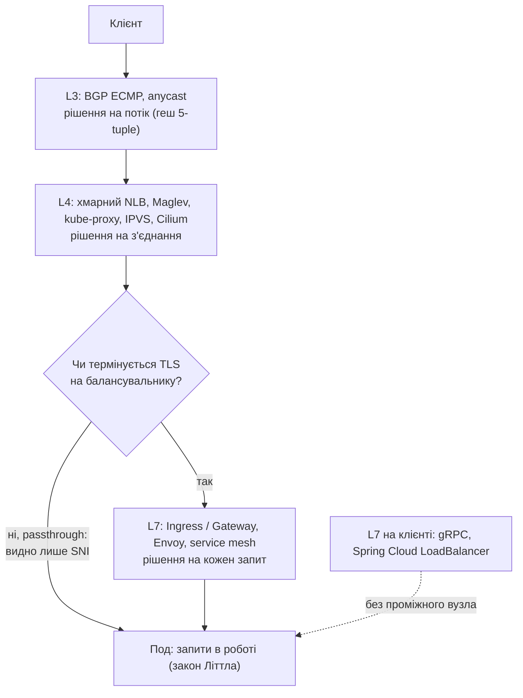

### Анотація

Балансувальник рівня L4 обирає бекенд один раз на з'єднання і не бачить запитів усередині нього. Балансувальник рівня L7 розподіляє кожен запит і знає, скільки запитів у роботі на кожному бекенді, але як використати цю інформацію, вирішує алгоритм: Round Robin, Least Connections, вибір кращого з двох випадкових кандидатів (P2C), Join-Idle-Queue чи consistent hashing.

У статті ці алгоритми розглянуто від теорії масового обслуговування (закон Літтла, supermarket model, універсальний закон масштабованості) до вимірів на власному прототипі проксі на віртуальних потоках Java 21 у кластері Kubernetes, з передбаченнями, записаними до кожного запуску. Алгоритми порівняно на однакових і неоднорідних подах та за мінливого часу обробки; виміряно, як застаріла інформація і кілька реплік балансувальника знецінюють Least Connections, і знайдено для цього емпіричну формулу; оцінено ціну прив'язки запитів до пода в consistent hashing з обмеженням навантаження та вартість самого проксі. Окремо показано, де алгоритм налаштовують у Kubernetes: в Ingress, Gateway API і service mesh.

## Вступ: чому розподілу з'єднань недостатньо

Балансувальники рівня L4 -- kube-proxy, IPVS, хмарні мережеві балансувальники (NLB) -- обирають бекенд один раз на з'єднання, без знання про запити всередині нього. Найчастіше вибір випадковий або за гешем адрес, а далі всі запити з'єднання йдуть на той самий бекенд. Наслідки такого вибору я виміряв для kube-proxy в окремій статті ([«Як kube-proxy балансує навантаження»]()), і вони стосуються будь-якого балансування з'єднань:
* **Довгі з'єднання розподіляються нерівномірно.** Якщо клієнтських з'єднань удвічі менше, ніж бекендів, близько 60% бекендів не отримують трафіку взагалі, а щойно додані бекенди не отримують його, доки клієнти не перевідкриють з'єднання. Там само виміряно, як обирати поріг HPA під очікуваний стрибок навантаження ([«Поріг HPA і стрибок навантаження»](#поріг-hpa-і-стрибок-навантаження)).
* **Навіть короткі з'єднання дають довгий хвіст затримок.** На 10 однакових бекендах при завантаженні 90% випадковий вибір дає P95 447 мс, а балансувальник, що бачить запити в роботі, -- 165–173 мс.
* **Ємність пулу визначає найповільніший бекенд.** Пул із десяти бекендів, де один удвічі повільніший, перевантажується вже за завантаження близько 53%, і P95 сягає секунд, хоча медіана лишається в межах 40–60 мс.

Отже, коли з'єднання довгі, бекенди неоднорідні або завантаження близьке до насичення, потрібен балансувальник, що розподіляє *запити* і бачить, скільки їх у роботі на кожному бекенді. Ця стаття -- про такі балансувальники: як працюють Round Robin, Least Connections і вибір із двох випадкових кандидатів (P2C), чому промислові проксі за замовчуванням обирають P2C і в яких умовах різниця між алгоритмами стає істотною. Окремо розглянуто три питання, що виникають на практиці: що відбувається, коли інформація про черги застаріла або балансувальників кілька; чого коштує прив'язка запитів до пода (consistent hashing); скільки коштує сам L7-балансувальник.

### Де L7-балансування в Kubernetes

Сам Kubernetes на рівні L7 не балансує: `Service` і kube-proxy розподіляють з'єднання, а Ingress і Gateway API описують маршрутизацію за хостом і шляхом, але алгоритм розподілу запитів залишають реалізації. Алгоритми, про які йдеться в статті, загальні й працюють однаково на віртуальних машинах і в кластері. У Kubernetes вони з'являються в чотирьох місцях:
* **Ingress-контролери** (Traefik, NGINX Ingress Controller від F5) -- для трафіку ззовні кластера. Найпоширеніший із них, спільнотний `ingress-nginx`, знято з підтримки: у березні 2026 року розробку припинено, репозиторій переведено в режим лише для читання, оновлень безпеки більше немає, а як шлях міграції Kubernetes рекомендує Gateway API [12];
* **реалізації Gateway API** (Envoy Gateway, Istio, Cilium, Traefik та інші) -- наступник Ingress, докладніше нижче;
* **service mesh** (Istio на Envoy, Linkerd) -- проксі поруч із кожним подом, тож балансуються й виклики всередині кластера; Linkerd, наприклад, надсилає запити на ендпоінти з найменшою ковзною середньою затримкою (EWMA) [9];
* **балансування на клієнті** -- gRPC-клієнт або бібліотека на кшталт Spring Cloud LoadBalancer отримує адреси всіх подів (через headless `Service`, у якого DNS повертає IP подів) і сам обирає под для кожного запиту.

**Gateway API і алгоритм балансування.** Gateway API розділяє відповідальність: `GatewayClass` і `Gateway` описують сам балансувальник і його слухачі, `HTTPRoute` -- правила маршрутизації та ваги між сервісами (`backendRefs[].weight`). Вибору *алгоритму* розподілу запитів між подами одного сервісу в стандартному API немає. Єдина стандартна політика рівня бекенду, `BackendLBPolicy` (GEP-1619), перебуває в експериментальному каналі й описує лише закріплення сесій за подом (session persistence) [13]. Алгоритм задають власні політики реалізацій, які прив'язуються до маршруту через `targetRefs`. Наприклад, в Envoy Gateway:

```yaml
apiVersion: gateway.envoyproxy.io/v1alpha1
kind: BackendTrafficPolicy
metadata:
  name: least-request-policy
spec:
  targetRefs:
    - group: gateway.networking.k8s.io
      kind: HTTPRoute
      name: app-route
  loadBalancer:
    type: LeastRequest   # також RoundRobin, Random, ConsistentHash
```

Без цієї політики Envoy Gateway за замовчуванням використовує саме `LeastRequest` [14]. За однакових ваг Envoy реалізує його як вибір кращого з двох випадкових подів [6], тобто як P2C із розділу про supermarket model, а не як пошук мінімуму серед усіх. Інші реалізації задають алгоритм кожна по-своєму:

| Реалізація | Де задають алгоритм | Варіанти | За замовчуванням |
| --- | --- | --- | --- |
| Envoy Gateway | `BackendTrafficPolicy`, `loadBalancer.type` | `RoundRobin`, `Random`, `LeastRequest`, `ConsistentHash` | `LeastRequest` (P2C) [14] |
| Istio | `DestinationRule`, `trafficPolicy.loadBalancer` | `ROUND_ROBIN`, `LEAST_REQUEST`, `RANDOM`, `PASSTHROUGH`, `consistentHash` (`ringHash` або `maglev`) | `LEAST_REQUEST` з версії 1.14, раніше `ROUND_ROBIN` [20] |
| Traefik | сервіс (`TraefikService` у Kubernetes), `strategy` | `wrr`, `p2c`, `hrw` (геш IP клієнта), `leasttime` | `wrr` [21] |
| Linkerd | не налаштовується | вбудований P2C за ковзною середньою затримкою (EWMA); з версії 2.20 враховує й відповіді 429 | -- [9], [22] |

Istio змінив значення за замовчуванням із причини, яку цей розділ вимірює: round robin перевантажує окремі поди, а експерименти команд Istio та Envoy показали перевагу `LEAST_REQUEST` [20]. У тому самому `DestinationRule` налаштовують і `outlierDetection` -- тимчасове виключення пода, що повертає помилки. Це не алгоритм розподілу, а захист від несправного пода; повільний, але справний под він не виключить, і тут потрібен алгоритм, що враховує черги.

Отже, перехід з Ingress на Gateway API не змінює самих алгоритмів: змінюється лише те, де їх налаштовують, і налаштування не переносяться між реалізаціями.

Окремий випадок -- **Gateway API Inference Extension** для серверів LLM-моделей. Ресурс `InferencePool` передає вибір пода не алгоритму проксі, а окремому компоненту (endpoint picker), який оцінює поди за їхніми метриками: довжиною черги запитів і заповненням кешу KV [15]. Це балансування за звітами бекендів, яке в цій статті розглянуто в розділі про застарілу інформацію: метрики надходять із запізненням, тож питання «стада» для нього таке саме.

Важлива для всіх чотирьох місць деталь: балансувальник рідко буває один. Ingress- і Gateway-контролери мають кілька реплік для надійності, і клієнти розподіляються між ними тим самим kube-proxy; у service mesh проксі стоїть поруч із кожним подом, а при балансуванні на клієнті балансувальником є кожен клієнт. Кожен із них бачить лише власні запити, і саме це обмеження досліджено в розділі про кілька екземплярів балансувальника.

## Теоретичні основи

### Закон Літтла і вартість запитів у роботі

Закон Літтла [5] пов'язує три величини стаціонарної системи: середню кількість запитів у роботі $L$, інтенсивність потоку $\lambda$ і середній час перебування запиту $W$:

$$L = \lambda W.$$

Для балансування з нього випливають два наслідки.

**Кількість запитів у роботі -- найдешевший показник черги.** L7-балансувальник бачить, скільки запитів він відправив на кожен бекенд і ще не отримав відповіді. Для бекенду $i$ це $L_i = \lambda_i W_i$: за однакового потоку більше запитів у роботі має той бекенд, що відповідає повільніше. Least Connections і P2C використовують саме цей лічильник, а балансувальник на рівні L4 його не має: він бачить з'єднання, а не запити.

**Утримання $L$ лягає на застосунок.** Наприклад, при $\lambda = 10\,000$ RPS та $W = 0.2$ с система має одночасно утримувати $L = 2\,000$ запитів. За моделлю «потік ОС на запит» це 2000 платформних потоків з окремими стеками. **Віртуальні потоки Java 21 (Project Loom)** знижують вартість одного очікуючого запиту до невеликого об'єкта в купі JVM, тож таке $L$ перестає бути обмеженням за ресурсами потоків.

### Один вибір, два вибори і supermarket model

**Статична задача.** Розкладемо $n$ куль по $n$ комірках. Якщо кожна куля потрапляє у випадкову комірку ($d = 1$), найзаповненіша комірка з високою ймовірністю містить

$$L_{\max}^{(d=1)} = \frac{\ln n}{\ln \ln n}\,(1 + o(1))$$

куль. Якщо ж кожна куля обирає менш заповнену з $d \ge 2$ випадкових комірок,

$$L_{\max}^{(d)} = \frac{\ln \ln n}{\ln d} + \Theta(1)$$

(Azar, Broder, Karlin, Upfal, 1994) [1]. Перехід від одного вибору до двох змінює порядок зростання з $\ln n / \ln \ln n$ на $\ln \ln n$, а кожен наступний вибір лише ділить результат на $\ln d$. Майже весь виграш дає другий вибір. Модель $d = 1$ перевірено експериментально на kube-proxy: довгі з'єднання він розподіляє саме так ([«Як kube-proxy балансує навантаження»]()).

**Динамічна задача (supermarket model).** У реальному балансуванні запити не лише приходять, а й завершуються. Класична модель: $n$ серверів з експоненційним часом обслуговування, пуассонівський потік із завантаженням $\lambda < 1$ на сервер, кожен запит обирає найкоротшу з $d$ випадкових черг. При $n \to \infty$ частка серверів, у черзі яких щонайменше $k$ запитів, дорівнює

$$s_k = \lambda^{\frac{d^k - 1}{d - 1}},$$

тобто $\lambda^k$ для $d = 1$ (кожен сервер -- незалежна $M/M/1$) і $\lambda^{2^k - 1}$ для $d = 2$ (Mitzenmacher, 2001; огляд -- Mitzenmacher, Richa, Sitaraman, 2001) [4], [2]. Хвіст черги спадає не експоненційно, а подвійно експоненційно: при $\lambda = 0{,}9$ черга з п'яти і більше запитів є на 59% серверів за випадкового вибору і на 3,8% за двох виборів.

Середній час перебування запиту в одиницях середнього часу обслуговування:

| Завантаження $\lambda$ | $d = 1$ | $d = 2$ | $d = 3$ |
| ---: | ---: | ---: | ---: |
| 0,7 | 3,33 | 1,61 | 1,36 |
| 0,9 | 10,0 | 2,61 | 2,03 |
| 0,99 | 100 | 5,43 | 3,86 |

За випадкового вибору час росте як $1/(1-\lambda)$, тобто гіперболічно, як у формулі Кінгмана. За двох виборів -- лише як $\ln \frac{1}{1-\lambda}$. Біля насичення різниця сягає десятків разів, а третій вибір знову додає порівняно мало.

Ці результати асимптотичні ($n \to \infty$) і отримані для однопотокових серверів з експоненційним часом обслуговування. Для реальних конфігурацій -- 3–10 подів, кілька обробників у кожному -- вони дають напрямок і порядок ефекту, а кількісні передбачення в цій статті отримано імітаційним моделюванням тієї самої системи, що й на стенді.

**Least Connections -- це $d = n$.** Пошук найменш завантаженого серед усіх серверів дає найкоротші черги, але лише за точної інформації. Якщо стан черг відомий із запізненням або кожен із кількох балансувальників бачить лише власні запити, «найвільніший» сервер отримує всі запити, доки інформація не оновиться, і сам стає найзавантаженішим. Це називають стадною поведінкою (herd behavior): стадом стають не клієнти, а рішення балансувальників і разом із ними запити, які за короткий час на основі тієї самої застарілої картини спрямовуються на один сервер. Мітценмахер (2000) показав, що за застарілої інформації менше вибору краще [3]: $d = 2$ зберігає більшу частину переваги і не збирає стадо, а за дуже старої інформації найкраще взагалі її ігнорувати й обирати випадково. Інший підхід -- сімейство LSQ (Local Shortest Queue): кожен диспетчер шукає найкоротшу чергу у власній, можливо застарілій картині, яку зрідка оновлює; Варгафтік, Кеслассі та Орда (2020) довели, що така система стабільна, доки похибка локальних оцінок обмежена [10]. Самі ж промислові балансувальники використовують здебільшого вибір із двох: `LEAST_REQUEST` в Envoy за однакових ваг порівнює два випадкові хости (кількість кандидатів налаштовується, за замовчуванням 2) [6], у NGINX є директива `random two least_conn` [7], у HAProxy -- `balance random(2)` [8]. Документація HAProxy прямо називає причину: випадковий вибір уникає ефекту «забивання» (hammering effect) сервера, який дають `roundrobin` і `leastconn`, коли сервери часто додаються або прибираються.

### Join-Idle-Queue: сервер сам каже, що вільний

Усі алгоритми вище «тягнуть» інформацію: диспетчер перед вибором дивиться на лічильники. Join-Idle-Queue (Lu та ін., 2011) робить навпаки: сервер, що звільнився, сам реєструється в черзі вільних серверів одного випадково обраного диспетчера. Диспетчер надсилає запит серверу з цієї черги, а якщо вона порожня -- випадковому. Запит не потребує жодного обміну інформацією в момент вибору, тому JIQ створено саме для систем з багатьма диспетчерами; автори показали, що за великої кількості серверів він у десятки разів зменшує накладні витрати черг порівняно з вибором із двох [11].

Що краще для конкретної системи -- JIQ чи локальний LC/P2C, -- визначають два різні джерела інформації. Сигналів «я вільний» тим більше, чим більше вільних обробників у пулі, тобто вони залежать від розміру пулу й завантаження. Локальні лічильники, навпаки, слабшають із ростом кількості диспетчерів: кожен бачить дедалі меншу частку запитів.

Де саме проходить межа між ними, показують карти режимів у розділі про кілька реплік балансувальника.

### Масштабованість балансувальника: USL

Закон Ніла Гюнтера (Neil Gunther, 1993) [23]:

$$C(N) = \frac{N}{1 + \sigma (N - 1) + \kappa N (N - 1)}$$

де $\sigma$ -- фактор конкуренції (Contention), а $\kappa$ -- фактор узгодження стану (Coherency/Crosstalk).

Закон корисний як модель для міркувань про масштабування самих балансувальників. Якщо екземплярів балансувальника кілька, точний Least Connections вимагав би спільного лічильника з'єднань для кожного бекенду, тобто узгодження стану між екземплярами ($\kappa > 0$). P2C може працювати на локальних лічильниках кожного екземпляра без узгодження: інформація неточна, але вибір із двох кандидатів залишається стійким до цієї неточності. Перевірку на прототипі наведено в розділі про компроміси.

## Прототип L7-балансувальника

Щоб порівняти алгоритми, які розподіляють окремі запити, а не з'єднання, я написав мінімалістичний зворотний HTTP-проксі ([`L7LoadBalancer.java`](https://github.com/Olezha/Load-balancer/blob/main/core/src/L7LoadBalancer.java){:target="_blank" rel="noopener noreferrer"}):
* Використовує віртуальні потоки Java 21: `Executors.newVirtualThreadPerTaskExecutor()`.
* Кожен вхідний запит обслуговується окремим віртуальним потоком. Поки потік чекає відповіді бекенду, він не займає потік ОС.
* Для кожного бекенду веде лічильник запитів «у польоті» (in-flight), тобто локальне значення $L$ із закону Літтла.
* Реалізує три основні алгоритми: **Round Robin (RR)**, **Least Connections (LC)** та **Power of Two Choices (P2C)**; для окремих експериментів -- також Join-Idle-Queue, кільце consistent hashing з обмеженням навантаження і режим застарілої інформації.

```java
public BackendNode selectBackend() {
    return switch (algorithm) {
        case ROUND_ROBIN -> {
            // Обмежений лічильник: лишається в [0, n) і не переповнюється
            int size = backends.size();
            int index = roundRobinIndex.getAndUpdate(i -> (i + 1) % size);
            yield backends.get(index);
        }
        case LEAST_CONNECTIONS -> {
            int best = 0;
            int minConn = load(0);
            int ties = 1;
            for (int i = 1; i < backends.size(); i++) {
                int candidateConn = load(i);
                if (candidateConn < minConn) {
                    minConn = candidateConn;
                    best = i;
                    ties = 1;
                } else if (randomTies && candidateConn == minConn
                        && ThreadLocalRandom.current().nextInt(++ties) == 0) {
                    best = i; // кожен із рівних бекендів обирається рівноймовірно
                }
            }
            yield backends.get(best);
        }
        case POWER_OF_TWO_CHOICES -> {
            int idx1 = ThreadLocalRandom.current().nextInt(backends.size());
            int idx2 = ThreadLocalRandom.current().nextInt(backends.size());
            while (idx2 == idx1) {
                idx2 = ThreadLocalRandom.current().nextInt(backends.size());
            }
            yield backends.get(load(idx1) <= load(idx2) ? idx1 : idx2);
        }
    };
}
```

Метод `load(i)` повертає завантаження бекенду так, як його бачить балансувальник: за замовчуванням це власний лічильник запитів у роботі, а в режимі «дошки» (`--board-ms`) -- значення, яке бекенд повідомив під час останнього опитування. Least Connections за замовчуванням при рівності обирає перший бекенд, тож за малого навантаження той отримує трохи більше запитів; з `--lc-ties random` -- випадковий із рівних, щоб «ефект стада» в експерименті із застарілою інформацією не був наслідком реалізації.

Лічильник Round Robin обмежено діапазоном $[0, n)$ навмисно. Поширений варіант `Math.abs(counter.getAndIncrement() % n)` після переповнення `int` дає від'ємні залишки: `Math.abs` повертає коректний індекс, але порядок обходу перестає бути циклічним.

## Порівняння алгоритмів у кластері

Алгоритми порівнювалися на тому самому стенді, що й kube-proxy у статті про нього: кластер `k3d`, синтетичні бекенди з контрольованою ємністю, генератор з пуассонівським потоком запитів, калібрування стенда за моделлю $M/M/4$, передбачення, записані до запуску, і 3–5 повторів кожної конфігурації. Проксі запускався окремим подом і звертався до подів напряму, без ClusterIP. Методологія і сирі дані -- у [`kube-proxy-lab`](https://github.com/Olezha/Load-balancer/tree/main/kube-proxy-lab){:target="_blank" rel="noopener noreferrer"}.

### Однакові поди біля насичення і повільний под

P95, мс; 5 повторів, 95% довірчий інтервал. Випадковий вибір (kube-proxy) наведено як точку відліку.

| Сценарій | Подів | Випадковий | RR | LC | P2C |
| :--- | ---: | ---: | ---: | ---: | ---: |
| Однакові поди, $\rho = 0.9$ | 3 | 453 ± 128 | 325 ± 43 | 208 ± 14 | 228 ± 20 |
| | 10 | 447 ± 79 | 260 ± 6 | 165 ± 3 | 173 ± 3 |
| Один под удвічі повільніший, $\rho = 0.7$ | 3 | 10 591 ± 1 741 | 9 802 ± 2 377 | 194 ± 5 | 205 ± 4 |
| | 10 | 18 493 ± 5 263 | 13 501 ± 1 398 | 160 ± 1 | 167 ± 2 |

* **RR кращий за випадковий вибір лише з однаковими подами.** Він вирівнює кількість запитів, але не бачить черг. Повільному поду він віддає рівно $1/n$ запитів, тому в цьому сценарії не кращий за випадковий вибір.
* **LC і P2C близькі до нижньої межі.** Модель спільної черги на всі поди дає P95 не нижче 203 мс для 3 подів і 157 мс для 10; LC і P2C підходять до неї впритул і зменшують частку повільного пода приблизно вдвічі.
* **З одним проксі LC трохи кращий за P2C** (165 ± 3 проти 173 ± 3 мс): за точної інформації пошук мінімуму серед усіх подів виграє. Ця перевага зникає, щойно інформація стає неточною (наступний розділ).

### Мінливість часу обробки

Формули Кінгмана і Поллачека -- Хінчина кажуть, що черга росте лінійно з квадратом коефіцієнта варіації часу обробки $c_s^2$. Випадковий вибір не може обійти под, зайнятий довгим запитом, а балансування з урахуванням черг -- може. 10 однакових подів, середній час обробки 50 мс, $\rho = 0.8$; $c_s^2$ = 0 (сталий час), 1 (експоненційний) і 4, 16 (суміш коротких і довгих запитів з тим самим середнім). P95, мс: передбачення / виміряне (5 повторів, 95% довірчий інтервал):

| $c_s^2$ | Випадковий (kube-proxy) | RR | LC | P2C |
| ---: | ---: | ---: | ---: | ---: |
| 0 | 126 / 130 ± 5 | 54 / 66 ± 8 | 54 / 64 ± 5 | 69 / 74 ± 1 |
| 1 | 239 / 239 ± 18 | 179 / 181 ± 8 | 150 / 154 ± 2 | 156 / 160 ± 1 |
| 4 | 499 / 491 ± 54 | 460 / 465 ± 99 | 191 / 193 ± 7 | 207 / 205 ± 6 |
| 16 | 1 207 / 1 459 ± 169 | 1 263 / 1 335 ± 149 | 114 / 115 ± 14 | 140 / 149 ± 12 |

* **Перевага урахування черг росте з мінливістю.** Відношення P95 випадкового вибору до P2C -- 1,8; 1,5; 2,4 і 9,8 для $c_s^2$ = 0, 1, 4, 16 (передбачено 1,8; 1,5; 2,4; 8,6).
* **RR корисний лише за сталого часу обробки.** За $c_s^2 = 0$ він рівний LC, а за $c_s^2 \ge 4$ не кращий за випадковий вибір: рівна кількість запитів не означає рівних черг, коли запити різні.
* **За $c_s^2 = 16$ P95 у LC і P2C *нижчий*, ніж за $c_s^2 = 4$** (115 / 149 проти 193 / 205 мс). У суміші з важким хвостом 97% запитів короткі, і балансувальник проводить їх повз поди, зайняті довгими. Самі довгі запити видно в P99: у LC -- 914 ± 50 мс (передбачено 927).
* За $c_s^2 = 0$ виміряні RR і LC на 10–12 мс вищі за модель: коли черг майже немає, мережевий перехід і робота проксі, яких модель не враховує, стають помітною часткою затримки.

Той самий експеримент із рисунком описано в [статті про kube-proxy](#мінливість-часу-обробки).

## Кілька екземплярів балансувальника і застаріла інформація

Least Connections найкраще працює, коли балансувальник точно знає черги всіх бекендів. На практиці так буває рідко: Ingress має кілька реплік, і кожна бачить лише власні запити, а глобальні дані про завантаження (метрики, звіти бекендів) приходять із запізненням. Як показано в теоретичному розділі, із застарілою інформацією пошук мінімуму серед усіх збирає «стадо», а вибір кращого з двох випадкових кандидатів до цього стійкий [3]. Нижче це перевірено вимірами.

**Експеримент.** Бекенди публікують кількість запитів у роботі, а проксі опитує їх раз на $T$ мс, тобто бачить картину із запізненням до $T$. 10 однакових подів, $\rho = 0.8$, $T$ = 0 (точні локальні лічильники), 100, 500 і 2000 мс. Least Connections при рівності значень обирає под випадково, щоб «стадо» не було наслідком реалізації. RR і випадковий вибір (kube-proxy) інформацію про завантаження не використовують, тож слугують контролем.

Передбачення записано до запуску (імітація), виміряно 3 прогони кожної конфігурації. P95, мс: передбачення / виміряне (95% довірчий інтервал):

| $T$ | LC | P2C |
| ---: | ---: | ---: |
| 0 | 151 / 155 ± 6 | 156 / 159 ± 10 |
| 100 мс | 679 / 691 ± 64 | 186 / 195 ± 6 |
| 500 мс | 3 010 / 3 063 ± 13 | 342 / 350 ± 24 |
| 2000 мс | 12 696 / система не витримує | 969 / 1 018 ± 31 |

Контролі від $T$ не залежать: випадковий вибір (kube-proxy) -- 240 ± 43 мс (передбачення 239), RR -- 185 ± 11 мс (179).

Усі три гіпотези підтвердилися, а числа збіглися з імітацією в межах кількох відсотків:

* з точною інформацією ($T = 0$) LC і P2C рівні;
* вже за запізнення 100 мс -- це менше за два середні часи обробки -- LC утричі з половиною гірший за P2C. Запізнення, звичайне для метрик, перетворює «найкращий» алгоритм на найгірший;
* за $T$ = 2 с P2C (1 018 мс) гірший і за випадковий вибір, і за RR: дуже стару інформацію краще ігнорувати;
* LC за $T$ = 2 с доводить «стадо» до кінця. Дві секунди всі запити йдуть на один под, його черга росте на тисячі запитів, і від 29 до 84% запитів прогону завершуються помилкою. P95 решти запитів тут нічого не означає.

Висновок для практики: алгоритм, що шукає мінімум серед усіх бекендів, доречний лише тоді, коли інформація про черги точна, тобто коли балансувальник сам рахує власні запити. Для будь-яких зовнішніх даних про завантаження -- метрик, звітів бекендів, спільного стану між репліками -- потрібен вибір із двох випадкових кандидатів або ігнорування застарілих даних.


*Рис. P95 затримки залежно від запізнення інформації про завантаження подів $T$ (10 подів, $\rho = 0.8$). Точки -- виміри з 95% довірчими інтервалами (3 прогони), пунктирні лінії -- передбачення імітаційної моделі, записані до запуску. Round Robin і kube-proxy інформацію про завантаження не використовують, тож виміряні один раз. Вісь ординат логарифмічна.*

### Кілька реплік балансувальника

Застаріла дошка -- один спосіб втратити точну інформацію. Інший, звичайніший, -- кілька реплік балансувальника: Ingress- чи Gateway-контролер із двома–трьома репліками для надійності або проксі поруч із кожним клієнтом у service mesh. Клієнти розподіляються між репліками тим самим kube-proxy, і кожна репліка рахує лише власні запити. Под може бути зайнятий запитами інших реплік, а репліка цього не бачить.

**Експеримент.** $k$ = 1, 4 і 16 реплік проксі за одним `Service`; $\rho = 0.9$, по 4 обробники в поді. LC і P2C працюють на власних лічильниках кожної репліки; JIQ -- так, як описано в теоретичному розділі: под із вільним обробником реєструється в черзі випадкової репліки HTTP-запитом. Для 30 подів середній час обробки -- 150 мс замість 50: так трафік лишається тим самим (720 запитів на секунду), а стенд не впирається у власний CPU; імітація не має власного масштабу часу, тож передбачення для 150 мс рівно втричі більші. P95, мс: передбачення / виміряне (3 повтори, 95% довірчий інтервал):

| Подів | $k$ | LC | P2C | JIQ | Запитів із черги JIQ |
| ---: | ---: | ---: | ---: | ---: | ---: |
| 10 (50 мс) | 1 | 158 / 163 ± 6 | 171 / 177 ± 12 | 173 / 188 ± 29 | 44% |
| | 4 | 165 / 171 ± 8 | 186 / 188 ± 10 | 194 / 200 ± 8 | 28% |
| | 16 | 195 / 198 ± 5 | 213 / 219 ± 19 | 255 / 268 ± 38 | 12% |
| 30 (150 мс) | 1 | 453 / 454 ± 8 | 495 / 499 ± 25 | 468 / 471 ± 10 | 68% |
| | 4 | 468 / 477 ± 12 | 540 / 543 ± 28 | 495 / 505 ± 9 | 48% |

Без проксі (kube-proxy, випадковий вибір): 394 ± 20 мс для 10 подів і 1 286 ± 148 мс для 30.

* **Локальні LC і P2C слабшають із кількістю реплік, але повільно.** На 10 подах P95 LC зростає з 163 до 198 мс між $k = 1$ і $k = 16$ і лишається вдвічі кращим за випадковий вибір.
* **JIQ залежить від того, скільки вільних подів припадає на одну репліку.** На 10 подах він поступається LC за будь-якої кількості реплік і відстає тим більше, чим їх більше; частка запитів, що знаходять зареєстрований вільний под, падає з 44% до 12% -- так, як передбачає формула Lu et al. На 30 подах JIQ ближчий до LC (на 6% гірший при $k = 4$) і кращий за P2C.
* Виміряні значення відходять від передбачень на 0–9%; найбільше -- JIQ на 10 подах при $k = 1$ (188 проти 173 мс).
* Конфігурацію з 30 подами і 16 репліками на цьому стенді виміряти не вдалося: 1–10% запитів завершувалися помилкою, бо частина нових TCP-з'єднань між подами на одному вузлі не встановлювалася. Найбільше постраждав JIQ, реєстраційні повідомлення якого йдуть тією самою мережею. Помилки не залежать від алгоритму, тож ці результати відкинуто (деталі -- в журналі методології).

**Наскільки слабшає локальний Least Connections.** Імітація на сітці 5–200 подів, 1–256 реплік, 1–16 обробників у поді і завантаження 0,7–0,9 показала, що надлишок затримки локального LC над нижньою межею, поділений на надлишок випадкового вибору, $e$, не залежить від кількості подів і описується однією формулою:

$$\boxed{\,e \approx \frac{y}{y + 13}, \qquad y = \frac{k\,(1-\rho)}{\rho\,\sqrt{c/4}}\,}$$

де $k$ -- кількість реплік, $c$ -- обробників у поді. Константу 13 підібрано за картами для $c = 4$, форму з $\sqrt{c}$ знайдено на $c = 1$ і 16, а потім перевірено передбаченням, записаним заздалегідь, на $c = 2$ і 8: усі 27 придатних клітинок -- в межах 0,08. Зміст: репліка бачить у кожному поді частку $1/k$ запитів, а випадкові коливання кількості запитів у поді ростуть як $\sqrt{\rho c}$; чим більший запас $1-\rho$, тим більше важить невидиме. Для 3 реплік Ingress при $\rho = 0.7$ і 4 обробниках $y \approx 1{,}3$, $e \approx 0{,}09$: локальних лічильників цілком достатньо. Для 100 сайдкарів service mesh $y \approx 43$, $e \approx 0{,}77$ -- майже випадковий вибір, що узгоджується зі спостереженням авторів Prequal на стенді зі 100 клієнтами. Це результат моделі (однакові поди, експоненційний час обробки); у кластері його перевірено лише до 16 реплік.


*Рис. Втрачена частка переваги локального LC. Кожна точка -- середнє за пулами від 20 подів для одного поєднання $c$, $\rho$ і $k$; лінія -- формула. Для $c = 16$ точок немає: там навіть випадковий вибір лише на 33–36 мс гірший за нижню межу, і нормувати нема на що.*

**Коли JIQ кращий за локальний LC.** На тих самих картах JIQ випереджає локальний LC більш ніж на 5% за двох умов: реплік щонайменше вдвічі більше, ніж обробників у поді ($k \ge 2c$), і подів від ~50 (за помірного завантаження, $\rho = 0.7$, -- від ~20). Перша умова означає, що одна репліка бачить у середньому менше ніж половину запиту на под: її лічильники здебільшого нулі, і LC вибирає майже навмання. Друга -- що вільних подів вистачає, щоб списки вільних у реплік не порожніли: JIQ реєструє под, а не окремий обробник. З 117 клітинок карт, де JIQ кращий більш ніж на 5%, правило знаходить 106, а з 161, де він гірший більш ніж на 5%, помиляється в одній. Виграш JIQ зменшується з кількістю обробників у поді: до 52% при $c = 1$, до 25% при $c = 4$, 13% при $c = 8$ і лише 3% при $c = 16$. Це правило знайдено на тих самих картах і на нових даних не перевірено. Аналітично межу вивести не вдалося: модель частки влучань Lu et al. систематично недооцінює JIQ і знаходить лише 24 зі 117 клітинок, де він виграє.

**Що допомагає, коли реплік багато.** Імітацією на тій самій моделі (10–100 подів, 1–256 реплік, $\rho = 0.9$) перевірено три підходи з робіт останніх років:

* **Проби серверних лічильників** (у дусі Prequal, який Google використовує в YouTube [24]): кожен запит запускає дві асинхронні проби випадкових подів, що повертають *справжню* кількість запитів у поді, а репліка обирає под з найменшим значенням серед свіжих проб. P95 лишається 152–176 мс за будь-якої кількості реплік і подів -- майже як точний Least Connections з однією реплікою. Ціна -- два службові повідомлення на запит.
* **Локальні лічильники, виправлені звітами подів** (L-JSQ-Pull із теорії LED [25]): добре працює за кількох реплік, але за 256 реплік руйнується (P95 ~1,1 с): репліка порівнює справжні значення кількох подів зі своїми малими лічильниками для решти і спрямовує запити на ті поди, звітів від яких не отримала. Змішувати дані різного масштабу не можна.
* **JIQ з вищим порогом реєстрації** помітно допомагає лише на великих пулах із багатьма репліками.

Звідси практичний висновок: якщо реплік балансувальника десятки чи сотні, власні лічильники кожної репліки втрачають сенс, і перевагу дає лише сигнал, отриманий від самого пода.

## Коли потрібна прив'язка: ціна ConsistentHash

Усі алгоритми вище намагаються зменшити затримку. Consistent hashing (`RING_HASH` і `MAGLEV` в Envoy, `consistentHash` в Istio, `ConsistentHash` в Envoy Gateway) розв'язує іншу задачу: запити з однаковим ключем -- користувач, сесія, ключ кешу -- завжди потрапляють на той самий под. Це корисно, коли под тримає локальний кеш або стан сесії. Геш ключа визначає точку на кільці, а запит отримує под, чия точка йде наступною за годинниковою стрілкою [16]. Коли под зникає, переїжджають лише його ключі, а не всі. Maglev замість кільця будує таблицю, у якій частки подів майже рівні [17].

**Чого це коштує.** Гешування не дивиться на черги, тож кожен под отримує пуассонівський потік з інтенсивністю $\lambda \cdot \text{share}_i$, де $\text{share}_i$ -- частка трафіку його ключів. Це той самий випадковий вибір, що й у kube-proxy, але з *нерівними* частками. Нерівність має три джерела:

* **скінченна кількість ключів.** Ключі розкидаються по подах один раз, як кулі по комірках при $d = 1$, -- та сама модель, що й для довгих з'єднань у статті про kube-proxy. За 1 000 рівно популярних ключів на 10 подів найзавантаженіший под отримує на 15–20% більше середнього;
* **нерівні дуги кільця.** Кільце з сотнею точок на под дає под із часткою до 1,15 від середньої навіть за нескінченної кількості ключів;
* **популярні ключі.** Якщо один ключ несе більше ніж $1/(n\rho)$ трафіку (при $n = 10$, $\rho = 0.8$ -- 12,5%), його под перевантажений за будь-якого гешування.

Модель (суміш черг M/M/c з нерівними навантаженнями) і імітація дають такі передбачення для 10 подів по 4 обробники при $\rho = 0.8$ (P95, мс; медіана за 5 різних розкладів гешу). Для порівняння: випадковий вибір -- 243 мс, Least Connections -- 152 мс.

| Ключі | Ring hash | Maglev | Ring hash з обмеженням навантаження, $b = 1.25$ |
| --- | ---: | ---: | ---: |
| 1 000, рівно популярні | 462 (найгірший розклад -- 3 591) | 311 | 161, 73% запитів на «свій» под |
| 100 000, рівно популярні | 286 | 238 | -- |
| 1 000, Zipf ($s = 1$) | перевантаження | перевантаження | 164, 67% запитів на «свій» под |

Отже, consistent hashing без обмежень гірший за випадковий вибір, якщо ключів небагато, кільце грубе або є популярні ключі. Саме тому сам ConsistentHash не варто обирати «для рівномірності» -- він для прив'язки, а за рівномірність доводиться платити окремо.

**Обмеження навантаження (bounded loads).** Mirrokni, Thorup і Zadimoghaddam запропонували просте виправлення: под приймає запит, лише поки кількість запитів у ньому не перевищує $b$ середньої; інакше запит іде на наступний под кільця [18]. В Envoy це параметр `hash_balance_factor` (значення 125 означає $b = 1.25$) [19]. Параметр $b$ плавно розмінює прив'язку на затримку (1 000 ключів, рівно популярні / Zipf 1.0):

| $b$ | P95, мс | Запитів на «свій» под |
| ---: | ---: | ---: |
| 1.05 | 154 / 155 | 54 / 51% |
| 1.25 | 161 / 164 | 73 / 67% |
| 1.5 | 175 / 185 | 86 / 78% |
| 2 | 206 / 303 | 95 / 85% |
| 3 | 289 / 5 500 | 99 / 90% |

За $b = 1.25$ затримка лише на 6–8% гірша за Least Connections, а дві третини запитів зберігають прив'язку. Обмеження працює, бо використовує ту саму інформацію, що й Least Connections, -- кількість запитів у роботі. Звідси й застереження: з кількома репліками балансувальника кожна бачить лише власні запити, і обмеження слабшає так само, як локальний Least Connections у розділі про кілька екземплярів.

**Перевірка в кластері.** Щоб перевірити ці передбачення, у прототип проксі додано кільце зі 100 точками на под і обмеженням навантаження, а генератор надсилає ключ кожного запиту в заголовку `X-Key`. 10 подів, $\rho = 0.8$, 1 000 ключів, 5 повторів -- і кожен повтор з новим розкладом кільця. Для кільця без обмеження передбачення рахувалося окремо для кожного розкладу, ще до вимірювання. P95, мс: передбачення / виміряне:

| Конфігурація | Рівно популярні ключі | Zipf ($s = 1$) | Запитів на «свій» под |
| --- | ---: | ---: | ---: |
| kube-proxy | 239 / 239 ± 15 | -- | -- |
| Least Connections | ~155 / 154 ± 2 | -- | -- |
| Кільце, $b = 1.25$ | 161 / 162 ± 2 | 164 / 165 ± 3 | 73% і 65% |
| Кільце, $b = 2$ | 206 / 204 ± 11 | 303 / 307 ± 35 | 95% і 83% |

Кільце без обмеження на п'яти розкладах дало P95 від 306 мс до 3,9 с, у медіані -- 1,4 с, ушестеро гірше за kube-proxy. Три розклади з п'яти модель заздалегідь позначила як перевантажені: найзавантаженіший под отримував на 2–6% більше, ніж здатен обробити. Саме вони дали найбільші затримки. Обмеження навантаження виправляє це майже повністю: за $b = 1.25$ затримка лише на 5–7% гірша за Least Connections, а частка запитів на «свій» под збіглася з передбаченою в межах двох відсоткових пунктів.

## Компроміси: затримка проти накладних витрат

### Пропускна здатність одного проксі

**Як це виміряно** (експеримент 7, передбачення записано до запуску). Проксі обмежено одним ядром CPU, щоб вузьким місцем був він, а не бекенди; $N$ клієнтів на постійних з'єднаннях шлють наступний запит одразу після відповіді (замкнена модель навантаження), $N$ = 1, 2, 4, …, 256; $\sigma$ і $\kappa$ оцінено лінійною регресією $N/C(N) - 1 = \sigma(N-1) + \kappa N(N-1)$. Передбачення: пропускна здатність виходить на плато ($\sigma > 0$), ретроградної ділянки до $N = 256$ немає (інтервал $\kappa$ включає 0), а максимальна пропускна здатність однакова для RR, LC і P2C.

Результат (3 повтори на кожне $N$):

| | $X(1)$, запитів/с | $\sigma$ | $\kappa$ | $X$ при $N$ = 128 / 256 |
| --- | ---: | ---: | ---: | ---: |
| RR | 347 | 0,064 ± 0,012 | 0,00003 ± 0,00005 | 5 098 / 4 614 |
| LC | 352 | 0,038 ± 0,061 | 0,00034 ± 0,00026 | 4 977 / 3 142 |
| P2C | 350 | 0,070 ± 0,008 | −0,00003 ± 0,00004 | 4 938 / 5 269 |

* **Межа -- одне ядро, а не алгоритм.** Усі три алгоритми виходять на ~5 000 запитів за секунду; вибір бекенду коштує мало порівняно з розбором і пересиланням HTTP.
* **Ретроградної ділянки в RR і P2C немає** (інтервал $\kappa$ містить 0). У LC при $N = 256$ два повтори з трьох упали до ~2 200 запитів за секунду, звідси $\kappa > 0$; але розкид між повторами за того самого $N$ сягає двох разів, тож це «можливий спад», а не виміряна вартість узгодження.
* Перший прогін цього експерименту довелося відкинути: проксі, обмежений одним ядром, у перші секунди віддавав процесор компілятору JIT, і перші вимірювання після кожного перезапуску були втричі гіршими. Для вимірювань пропускної здатності JVM потрібен окремий прогрів.

### Затримка проти процесора: фронт Парето

Вибір балансувальника -- компроміс щонайменше між двома величинами: затримкою під навантаженням і вартістю самого балансування. Зведення їх у зважену суму вимагає ваг, які неможливо обґрунтувати, тому конфігурації порівнюються без ваг: конфігурація лежить на фронті Парето, якщо жодна інша не краща за обома показниками одночасно.

**Як це виміряно** (експеримент 8, передбачення записано до запуску). 10 однакових подів, завантаження 90%; P95 затримки і CPU пода проксі за лічильником cgroup. kube-proxy працює в ядрі, і його витрати не прив'язані до пода, тож для нього вартість у просторі користувача дорівнює нулю. Передбачення: CPU у RR, LC і P2C однаковий, тож RR домінований (та сама вартість, гірший P95), а на фронті лишаються kube-proxy як крайня точка з нульовою вартістю і LC/P2C.

Результат (3 повтори; CPU проксі -- секунди процесора за 72-секундний прогін):

| Конфігурація | P95, мс: передбачення / виміряне | CPU проксі, ядер |
| --- | ---: | ---: |
| kube-proxy | 447 / 411 ± 162 | 0 (ядро ОС, не вимірюється) |
| RR | 260 / 274 ± 20 | 1,3 |
| LC | 165 / 163 ± 10 | 1,1–1,2 |
| P2C | 173 / 178 ± 3 | 1,3 |

RR домінований: він коштує стільки ж процесора, як LC і P2C, але дає гірший P95. Фронт складають kube-proxy (нуль процесора в просторі користувача, найгірший хвіст) і LC / P2C: ~1,2 ядра на 720 запитів за секунду за P95, менший у 2,4 раза. Це ціна прототипу на Java з новим з'єднанням на кожен запит; промислові проксі (Envoy, HAProxy) дешевші, але сама форма компромісу -- «процесор проксі за хвіст затримки» -- та сама. У перших двох прогонах CPU виміряно помітно нижчим (45 і 68 с замість 82–97) за нормальної затримки; причину не встановлено, і на висновок це не впливає.

## Де працює L7-балансування: зіставлення з ЕМВВС (OSI)

Позначки «L4» і «L7» в назвах балансувальників означають не місце в мережі, а одиницю рішення: що саме балансувальник розподіляє і що він при цьому бачить. Запит від клієнта до пода в хмарі зазвичай проходить кілька балансувальників різних рівнів, і кожен вищий рівень знає більше, але й коштує більше.



| Рівень | Одиниця рішення | Що бачить балансувальник | Приклади |
| --- | --- | --- | --- |
| L3, мережевий | Потік пакетів | Адреси й порти (геш 5-tuple) | BGP ECMP, anycast |
| L4, транспортний | Нове з'єднання | 5-tuple, кількість з'єднань | Хмарні NLB, Maglev, Katran, kube-proxy, IPVS, Cilium (eBPF) |
| L5–L6 | -- | -- | TLS, серіалізація (JSON, Protobuf) |
| L7, прикладний | Кожен запит або потік HTTP/2 | Метод, шлях, заголовки, кількість запитів у роботі, коди відповідей, затримки | Envoy, NGINX, HAProxy, Traefik; Ingress, Gateway API, service mesh; клієнтський gRPC |

Рівні 5 і 6 у стеку TCP/IP окремо не існують: TLS і серіалізацію виконує або застосунок, або проксі, що термінує з'єднання. Для балансування вони важливі лише тим, чи може балансувальник прочитати запит. З цієї схеми випливає кілька практичних наслідків.

* **HTTP/2 і gRPC перетворюють L4-балансувальник на розподільник клієнтів.** В одному з'єднанні мультиплексуються сотні запитів, а L4-балансувальник бачить одне з'єднання і відправляє все на один под. L7-проксі розбирає потоки HTTP/2 і розподіляє кожен окремо -- саме тому для gRPC балансування на L7 обов'язкове.
* **TLS визначає, чи балансувальник може бути L7.** Якщо TLS термінується на проксі, той бачить запити. Якщо ж трафік іде наскрізь (`tls.mode: Passthrough` у слухача Gateway API), проксі бачить лише ім'я сервера в TLS (SNI) і розподіляє з'єднання, тобто працює як L4 з усіма наслідками зі статті про kube-proxy. Розподіл запитів тоді можливий лише на клієнті.
* **Прив'язка буває на обох рівнях, і вони не рівноцінні.** `sessionAffinity: ClientIP` у `Service` -- прив'язка на L4 за адресою клієнта: за NAT або балансувальником попереду всі клієнти можуть мати одну адресу й потрапити на один под. Прив'язка на L7 (consistent hashing за cookie, заголовком чи ідентифікатором користувача) розрізняє самих клієнтів і може обмежувати навантаження.
* **Балансування на клієнті -- теж L7, лише без проміжного вузла.** Клієнт бачить власні запити й відповіді, тож може застосувати LC чи P2C, не додаючи мережевого переходу. Ціна -- кожен клієнт стає окремою реплікою балансувальника з усіма обмеженнями з розділу про кілька екземплярів.
* **Перехід L4 → L7 має вимірну ціну.** Проксі термінує TCP (і TLS), розбирає HTTP і тримає два з'єднання замість одного. На стенді це близько 10 мс понад модель за майже порожніх черг (експеримент з мінливістю, $c_s^2 = 0$) і ~1,2 ядра на 720 запитів за секунду з новим з'єднанням на кожен запит (розділ про компроміси). Біля насичення ця ціна окупається: P95 зменшується в 2–3 рази, а з повільним подом -- на два порядки.

**Ті самі вибори поза HTTP.** Брокери повідомлень розв'язують ту саму задачу розподілу, і на них переносяться висновки статті. У RabbitMQ `prefetch_count` обмежує кількість непідтверджених повідомлень на споживача: брокер не надсилає нове повідомлення зайнятому споживачу, і це наближається до LC з обмеженням або до JIQ, де вільний обробник сам отримує роботу. У Kafka повідомлення з ключем потрапляє в розділ за гешем ключа за модулем кількості розділів, а розділ закріплено за одним споживачем. Це прив'язка, як у consistent hashing, з тим самим ризиком популярних ключів, але без його стійкості: додавання розділів переносить більшість ключів.

## Висновки

1. **L7-балансувальник розподіляє запити, а не з'єднання, і тому бачить черги.** Саме це дає йому перевагу над kube-proxy: на 10 однакових подах біля насичення ($\rho = 0.9$) P95 знижується з 447 мс до 165 мс (LC) і 173 мс (P2C), а з одним повільним подом -- з 18 с до 160–167 мс. Обидва результати близькі до нижньої межі, яку дає модель спільної черги на всі поди.

2. **Round Robin -- не алгоритм балансування навантаження, а алгоритм рівного розподілу запитів.** Він вирівнює кількість запитів, але не черги. RR корисний лише тоді, коли поди однакові, а час обробки сталий; з повільним подом або мінливим часом обробки ($c_s^2 \ge 4$) він не кращий за випадковий вибір. Istio із тієї самої причини змінив значення за замовчуванням з `ROUND_ROBIN` на `LEAST_REQUEST`.

3. **Чим мінливіший час обробки, тим більше важить урахування черг.** За однакового середнього 50 мс і $c_s^2 = 16$ P95 випадкового вибору -- 1,5 с, а LC і P2C -- 115–149 мс, удесятеро менше. LC і P2C обходять под, зайнятий довгим запитом; хвіст довгих запитів лишається видимим у P99.

4. **Інформація про черги корисна, лише поки вона свіжа.** Least Connections за точних лічильників -- найкращий, а вже із запізненням 100 мс (менше двох середніх часів обробки) -- утричі з половиною гірший за P2C; за 2 с система з LC не витримує навантаження. Вибір кращого з двох випадкових подів (P2C) значно стійкіший, хоча за 2 с і він гірший за алгоритми, що інформацію ігнорують. Практичне правило: зовнішні дані про завантаження (метрики, звіти бекендів, спільний стан) -- лише з випадковим вибором серед кількох кандидатів, ніколи «мінімум серед усіх».

5. **Кілька реплік балансувальника -- це теж застаріла інформація.** Кожна репліка Ingress- чи Gateway-контролера бачить лише власні запити, тож перевага LC і P2C зменшується з кількістю реплік $k$: на 10 подах при $\rho = 0.9$ P95 LC зростає з 163 мс ($k = 1$) до 198 мс ($k = 16$), лишаючись удвічі кращим за випадковий вибір (394 мс). Імітація показує, що нормоване погіршення локального LC не залежить від кількості подів і описується однією величиною $y = k(1-\rho)/(\rho\sqrt{c/4})$: для кількох реплік Ingress локальних лічильників досить, для сотні сайдкарів вони майже не кращі за випадковий вибір. Коли реплік десятки, перевагу дає лише сигнал від самого пода -- наприклад, P2C на пробах, як у Prequal.

6. **Join-Idle-Queue вигідний лише на великих пулах і за багатьох реплік.** Він не потребує лічильників, але потребує вільних подів: за високого завантаження та малих пулів їх бракує, і JIQ поступається локальному LC (на 10 подах при $k = 16$: 268 проти 198 мс). Це узгоджується з теорією: якість JIQ визначає кількість вільних серверів на один диспетчер (Lu et al.). На 30 подах JIQ уже кращий за P2C і лише на 6% гірший за LC. Імітація дає емпіричне правило: JIQ виграє, коли реплік щонайменше вдвічі більше, ніж обробників у поді, і подів від ~50; виграш тим менший, чим більше обробників у поді (до 52% при одному, 3% при шістнадцяти).

7. **ConsistentHash -- для прив'язки, а не для рівномірності.** Без обмеження він працює як випадковий вибір із нерівними частками подів: за тисячі ключів, грубого кільця або популярних ключів він гірший за kube-proxy, а ключ із часткою трафіку понад $1/(n\rho)$ перевантажує свій под за будь-якого гешування. Обмеження навантаження ($b = 1.25$, `hash_balance_factor` в Envoy) повертає затримку майже до рівня LC і зберігає прив'язку для двох третин запитів (у кластері: P95 на 5–7% гірший за LC, на «свій» под -- 73% запитів для рівно популярних ключів і 65% для Zipf).

8. **Алгоритм не є частиною стандартного API Kubernetes.** Ні Ingress, ні Gateway API його не задають: це роблять власні політики реалізацій (`BackendTrafficPolicy`, `DestinationRule`, `strategy` у Traefik), і налаштування не переносяться між ними. Добра новина -- типові значення за замовчуванням уже розумні: Envoy Gateway та Istio використовують `LeastRequest`, який за однакових ваг є P2C, Linkerd -- P2C із затримкою.

9. **Ціна L7-балансування -- процесор проксі, а не алгоритм.** На стенді всі алгоритми впираються в ту саму межу одного ядра (~5 000 запитів за секунду), а RR коштує стільки ж, скільки LC і P2C, тож за рівної ціни немає причин обирати RR. Компроміс справжній лише між kube-proxy (без процесора в просторі користувача, гірший хвіст) і будь-яким L7-балансувальником з урахуванням черг.

### Як обрати алгоритм

| Ситуація | Рекомендація |
| --- | --- |
| Довгі з'єднання (gRPC, HTTP/2, keep-alive) | L7-балансування обов'язкове: kube-proxy розподіляє лише з'єднання |
| Однакові поди, сталий час обробки | Будь-який алгоритм; RR не гірший за інші |
| Мінливий час обробки або різні поди | LC (одна репліка) або P2C |
| Кілька реплік балансувальника | До кількох реплік -- P2C або LC на власних лічильниках; десятки і більше -- P2C на пробах серверних лічильників (як у Prequal) |
| Зовнішні метрики завантаження із запізненням | Лише рандомізований вибір (P2C на метриках), не «мінімум серед усіх» |
| Потрібна прив'язка ключа до пода | ConsistentHash з обмеженням навантаження; перевірити популярні ключі |
| Від ~50 подів, реплік щонайменше вдвічі більше, ніж обробників у поді | JIQ-подібні схеми (под сам повідомляє, що вільний) або P2C на пробах |
| TLS наскрізь (passthrough), балансувальник бачить лише SNI | Це балансування з'єднань: термінувати TLS на проксі або балансувати на клієнті |

## Список використаних джерел

1. **Azar, Y., Broder, A. Z., Karlin, A. R., & Upfal, E. (1994).** Balanced Allocations. *Proceedings of the 26th ACM Symposium on Theory of Computing (STOC)*, 593–602; журнальна версія -- *SIAM Journal on Computing*, 29(1), 180–200 (1999).
2. **Mitzenmacher, M., Richa, A. W., & Sitaraman, R. (2001).** The Power of Two Random Choices: A Survey of Techniques and Results. In *Handbook of Randomized Computing*, Vol. I, 255–312. Springer.
3. **Mitzenmacher, M. (2000).** How Useful Is Old Information? *IEEE Transactions on Parallel and Distributed Systems*, 11(1), 6–20.
4. **Mitzenmacher, M. (2001).** The Power of Two Choices in Randomized Load Balancing. *IEEE Transactions on Parallel and Distributed Systems*, 12(10), 1094–1104.
5. **Little, J. D. C. (2011).** Little's Law as Viewed on Its 50th Anniversary. *Operations Research*, 59(3), 536–549.
6. **Envoy.** Supported load balancers: weighted least request. [envoyproxy.io/docs/envoy/latest/intro/arch_overview/upstream/load_balancing/load_balancers](https://www.envoyproxy.io/docs/envoy/latest/intro/arch_overview/upstream/load_balancing/load_balancers){:target="_blank" rel="noopener noreferrer"}.
7. **NGINX.** Module ngx_http_upstream_module: directive `random`. [nginx.org/en/docs/http/ngx_http_upstream_module.html](https://nginx.org/en/docs/http/ngx_http_upstream_module.html#random){:target="_blank" rel="noopener noreferrer"}.
8. **HAProxy 3.0.** Configuration Manual: `balance random(<draws>)`. [docs.haproxy.org/3.0/configuration.html](https://docs.haproxy.org/3.0/configuration.html#4.2-balance){:target="_blank" rel="noopener noreferrer"}.
9. **Linkerd.** Load Balancing. [linkerd.io/docs/features/load-balancing](https://linkerd.io/docs/features/load-balancing/){:target="_blank" rel="noopener noreferrer"}.
10. **Vargaftik, S., Keslassy, I., & Orda, A. (2020).** LSQ: Load Balancing in Large-Scale Heterogeneous Systems with Multiple Dispatchers. *IEEE/ACM Transactions on Networking*, 28(3), 1186–1198. [arXiv:2003.02368](https://arxiv.org/abs/2003.02368){:target="_blank" rel="noopener noreferrer"}.
11. **Lu, Y., Xie, Q., Kliot, G., Geller, A., Larus, J. R., & Greenberg, A. (2011).** Join-Idle-Queue: A Novel Load Balancing Algorithm for Dynamically Scalable Web Services. *Performance Evaluation*, 68(11), 1056–1071.
12. **Kubernetes Blog (2025).** Ingress NGINX Retirement: What You Need to Know. 11 листопада 2025. [kubernetes.io/blog/2025/11/11/ingress-nginx-retirement](https://kubernetes.io/blog/2025/11/11/ingress-nginx-retirement/){:target="_blank" rel="noopener noreferrer"}.
13. **Kubernetes Gateway API.** GEP-1619: Session Persistence. [gateway-api.sigs.k8s.io/geps/gep-1619](https://gateway-api.sigs.k8s.io/geps/gep-1619/){:target="_blank" rel="noopener noreferrer"}.
14. **Envoy Gateway.** Load Balancing. [gateway.envoyproxy.io/docs/tasks/traffic/load-balancing](https://gateway.envoyproxy.io/docs/tasks/traffic/load-balancing/){:target="_blank" rel="noopener noreferrer"}.
15. **Kubernetes SIGs.** Gateway API Inference Extension. [gateway-api-inference-extension.sigs.k8s.io](https://gateway-api-inference-extension.sigs.k8s.io/){:target="_blank" rel="noopener noreferrer"}.
16. **Karger, D., Lehman, E., Leighton, T., Panigrahy, R., Levine, M., & Lewin, D. (1997).** Consistent Hashing and Random Trees: Distributed Caching Protocols for Relieving Hot Spots on the World Wide Web. *Proceedings of the 29th ACM Symposium on Theory of Computing (STOC)*, 654–663.
17. **Eisenbud, D. E., Yi, C., Contavalli, C., Smith, C., Kononov, R., Mann-Hielscher, E., Cilingiroglu, A., Cheyney, B., Shang, W., & Hosein, J. D. (2016).** Maglev: A Fast and Reliable Software Network Load Balancer. *Proceedings of the 13th USENIX Symposium on Networked Systems Design and Implementation (NSDI)*, 523–535.
18. **Mirrokni, V., Thorup, M., & Zadimoghaddam, M. (2018).** Consistent Hashing with Bounded Loads. *Proceedings of the 29th ACM-SIAM Symposium on Discrete Algorithms (SODA)*, 587–604. [arxiv.org/abs/1608.01350](https://arxiv.org/abs/1608.01350){:target="_blank" rel="noopener noreferrer"}.
19. **Envoy.** Ring Hash Load Balancing Policy: `hash_balance_factor`. [envoyproxy.io/docs/envoy/latest/api-v3/extensions/load_balancing_policies/ring_hash/v3/ring_hash.proto](https://www.envoyproxy.io/docs/envoy/latest/api-v3/extensions/load_balancing_policies/ring_hash/v3/ring_hash.proto){:target="_blank" rel="noopener noreferrer"}.
20. **Istio.** Istio 1.14 Change Notes: Traffic Management. [istio.io/latest/news/releases/1.14.x/announcing-1.14/change-notes](https://istio.io/latest/news/releases/1.14.x/announcing-1.14/change-notes/){:target="_blank" rel="noopener noreferrer"}.
21. **Traefik.** Routing Configuration: HTTP Load Balancing, Service. [doc.traefik.io/traefik/reference/routing-configuration/http/load-balancing/service](https://doc.traefik.io/traefik/reference/routing-configuration/http/load-balancing/service/){:target="_blank" rel="noopener noreferrer"}.
22. **Linkerd (2026).** Announcing Linkerd 2.20: Rate-limit-aware load balancing. [linkerd.io/2026/06/23/announcing-linkerd-2.20](https://linkerd.io/2026/06/23/announcing-linkerd-2.20/){:target="_blank" rel="noopener noreferrer"}.
23. **Gunther, N. J. (2008).** A General Theory of Computational Scalability Based on Rational Functions. [arXiv:0808.1431](https://arxiv.org/abs/0808.1431){:target="_blank" rel="noopener noreferrer"}.
24. **Wydrowski, B., Kleinberg, R., Rumble, S. M., & Archer, A. (2024).** Load is not what you should balance: Introducing Prequal. *Proceedings of the 21st USENIX Symposium on Networked Systems Design and Implementation (NSDI)*, 1285–1299. [usenix.org/conference/nsdi24/presentation/wydrowski](https://www.usenix.org/conference/nsdi24/presentation/wydrowski){:target="_blank" rel="noopener noreferrer"}.
25. **Zhou, X., Shroff, N., & Wierman, A. (2021).** Asymptotically Optimal Load Balancing in Large-scale Heterogeneous Systems with Multiple Dispatchers. *Performance Evaluation*, 145, 102146. [arxiv.org/abs/2002.08908](https://arxiv.org/abs/2002.08908){:target="_blank" rel="noopener noreferrer"}.
